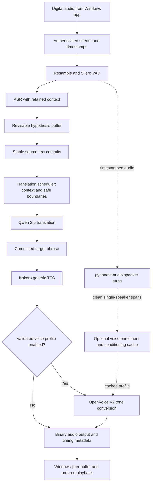

# Voxlate · Live translation pipeline

**Design proposal · Indian languages ↔ English · Two directions · Updated 12 October 2026**

[Project as implemented](README.md) · [Windows app plan](WINDOWS_APP.md)

> **Selected model plan:** Silero VAD → ASR → committed phrases → Qwen 2.5 → Kokoro, with OpenVoice V2 for optional voice cloning and pyannote.audio for speaker changes. Evaluate Llama 3 8B as the translation alternative, plus SeamlessStreaming, NLLB-200 and XTTS-v2 in permitted noncommercial experiments. Model roles and readiness conditions are defined in section 5.

This document evaluates the supplied meeting notes and specifies a proposed backend. The design, endpoints, timings, and milestones below are **not implemented or benchmark results**. The existing repository is a recorded-utterance web demo, described in the README. Server hardware and capacity budget remain undecided.

The translation and speech model choices below follow the project owner's requested list. Choose one translation path and one synthesis path per stream; do not run every candidate in sequence. The existing ASR shortlist is retained because this revision changes translation, voice synthesis, diarization and VAD choices.

## 1. Decisions at a glance

| Decision | Recommendation |
| --- | --- |
| First language pair | Hindi ↔ English, confirmed by the project owner |
| Expanded language scope | Bengali, Tamil, Telugu, Marathi, Gujarati, Kannada, Malayalam, Punjabi, Odia, Assamese and Urdu ↔ English; staged validation before release |
| Directions | Outgoing microphone translation and incoming meeting translation, with independent state |
| Audio source | Digital microphone capture and isolated meeting playback capture through virtual devices |
| Transport | Persistent authenticated WSS initially; binary audio, separate connection per direction |
| Audio cadence | Small capture frames; compare 40/100/200 ms network batches instead of assuming 200 ms is optimal |
| Text safety | Revisable ASR hypothesis → stable source commit → meaning-aware translation commit → speech |
| Translation | Qwen2.5-7B-Instruct first; Llama 3 8B alternative after Hindi adaptation/evaluation; SeamlessStreaming and NLLB-200 for permitted noncommercial comparison |
| Voice at first launch | Kokoro generic voice; optional OpenVoice V2 conversion after validation; XTTS-v2 as a permitted noncommercial cloning comparison |
| Voice enrollment | Store reusable conditioning/reference data; do not retrain a model for every phrase |
| Gender detector | Remove from the required pipeline; pitch is not a reliable gender label or speaker identity |
| Speech / silence | Silero VAD drives speech boundaries and long-pause events |
| Multi-speaker work | pyannote.audio detects speaker turns alongside ASR; generic incoming voice while IDs are uncertain |
| First success criterion | Understandable, accurate, stable conversation with measured delay—not an undetectability claim |

### Indian-language expansion

Keep Hindi ↔ English as the first end-to-end benchmark. Add the following **11 Indian languages** to the development roadmap, testing each in both directions with English. These are planned capabilities, not languages already implemented or validated in Voxlate. English remains available as a selectable language.

| Language | App language tag | Initial text script | Current plan / speech-output readiness |
| --- | --- | --- | --- |
| Hindi | `hi` | Devanagari | Pilot; Kokoro voice candidate available, end-to-end tests pending |
| Bengali (Bangla) | `bn` | Bengali | Expansion; ASR/translation evaluation and target-language TTS required |
| Tamil | `ta` | Tamil | Expansion; ASR/translation evaluation and target-language TTS required |
| Telugu | `te` | Telugu | Expansion; ASR/translation evaluation and target-language TTS required |
| Marathi | `mr` | Devanagari | Expansion; ASR/translation evaluation and target-language TTS required |
| Gujarati | `gu` | Gujarati | Expansion; ASR/translation evaluation and target-language TTS required |
| Kannada | `kn` | Kannada | Expansion; ASR/translation evaluation and target-language TTS required |
| Malayalam | `ml` | Malayalam | Expansion; ASR/translation evaluation and target-language TTS required |
| Punjabi | `pa-Guru` | Gurmukhi | Expansion; explicitly scope this variant to Gurmukhi |
| Odia | `or` | Odia | Expansion; verify a usable ASR checkpoint as well as translation/TTS |
| Assamese | `as` | Assamese | Expansion; ASR/translation evaluation and target-language TTS required |
| Urdu | `ur` | Perso-Arabic | Expansion; target-language TTS and right-to-left text handling required |

**The current voice-model list limits the rollout.** Kokoro's published voice catalog includes Hindi and English, but does not list the additional Indian languages above. XTTS-v2's published language list likewise includes Hindi, not these additional languages. OpenVoice conversion needs intelligible base speech; changing timbre does not supply a missing language-capable TTS engine. Broader commercial speech output therefore needs a validated adaptation or an additional licensed base TTS model selected in a later model decision. Keep the requested model list for now and record this as an unresolved dependency. [Kokoro voices](https://huggingface.co/hexgrad/Kokoro-82M/blob/main/VOICES.md), [XTTS-v2 languages](https://huggingface.co/coqui/XTTS-v2), [OpenVoice](https://github.com/myshell-ai/OpenVoice).

Evaluate Qwen 2.5 independently for each language; a multilingual label does not establish acceptable translation quality in every Indian language. Llama needs the appropriate language adaptation. For NLLB and SeamlessStreaming research comparisons, check the pinned checkpoint's exact language, script and output-modality coverage rather than inheriting Hindi results. Map app tags to each adapter's own language IDs; do not pass app tags unchanged to every model. [Qwen model card](https://huggingface.co/Qwen/Qwen2.5-7B-Instruct), [SeamlessStreaming model card](https://huggingface.co/facebook/seamless-streaming).

Roll out in this order:

1. Establish the Hindi ↔ English baseline.
2. Evaluate each added language ↔ English for ASR and text translation; test English speech output where the source-language stages pass. Mark the reverse speech direction unavailable until its TTS is ready.
3. Enable two-way speech only after both directions pass quality, latency and licensing checks. Test cloning separately for each target language.
4. Evaluate direct Indian-language pairs, such as Tamil ↔ Hindi or Bengali ↔ Marathi, after the English-pair tests. Do not assume pairwise support or silently translate through English; a pivot adds delay and may change meaning.

For the desktop language selectors, obtain the available pairs from the server. Show planned languages as unavailable or experimental with a reason; do not present them as working speech choices. A caption-only experiment must be explicitly selected and must not silently replace the promised two-way audio mode. The Windows layout's Hindi/English examples remain the pilot configuration.

## 2. Assessment of the meeting proposal

The approach has a sensible foundation, but several statements combine different technical capabilities. Implementing them literally would introduce avoidable latency and unreliable behavior.

| Meeting idea | Assessment | Revised implementation |
| --- | --- | --- |
| Take audio through the laptop speaker | Physical playback is output, not the desired capture source. Recording it acoustically introduces room noise and echo. | Capture microphone PCM for outgoing speech; capture meeting render audio digitally for incoming speech. |
| Send 200 ms chunks | Useful experiment, but chunk length is only one source of delay. | Separate device callback size, network batching, ASR context window, and linguistic commit window. Measure each. |
| First buffer waits for a proper phrase | Useful principle; ASR text stability and semantic completeness are different. | Keep rolling audio and revisable hypotheses. Commit stable words, then let a separate translation scheduler choose a safe phrase boundary. |
| Second buffer contains committed text | Keep it. | Assign immutable IDs, timestamps, stream/speaker IDs and a commit watermark. Never speak a revisable draft. |
| Frequency detector determines male/female | Not required for translation or cloning; pitch varies and does not identify a person. | Use a chosen fallback voice. Optional pitch/prosody estimates may guide style, not gender classification. |
| Diarization saves a voice permanently | Diarization labels turns; it does not train a cloning model or prove identity across calls. | Separate session speaker tracking from consented account enrollment and TTS conditioning. |
| Wait for the verb to translate | Often relevant for Hindi/English reordering, but a verb-only rule is insufficient. | Use direction-aware phrase boundaries, negation, clause context, endpointing and a bounded wait policy. |
| All listed models support streaming | They do not share the same streaming contract. | Distinguish incremental input, incremental output, and repeated inference over chunks. Verify the exact checkpoint/runtime. |
| Generic voice for five seconds, perfect clone after thirty | These are unverified product hypotheses. | Readiness depends on clean speech and model quality. Prefer enrollment before calls; never promise identity from elapsed time alone. |
| Gradually mix original voice and generic TTS | Mixing two speech waveforms can produce a doubled voice and does not transfer timbre. | Experiment with model-supported conditioning interpolation or tone conversion separately. Switch at phrase boundaries only after listening tests. |
| Send audio only when TTS is complete | Adds latency if the selected engine can emit playable audio earlier. | Start playback from the first valid output block when supported; otherwise synthesize short committed phrases. |
| Finish backend, then all desktop work | Backend quality needs early focus, but Windows virtual audio is also a major technical risk. | Run a small digital-routing proof before polishing UI; do not leave driver feasibility until the end. |

### What “seamless” can realistically mean

Target natural phrasing, stable voice, reliable turn-taking, no feedback, and no growing playback backlog. Translation must sometimes wait for information that has not been spoken yet. Camera lip movements will also lead translated audio. No architecture can promise zero delay, perfect voice identity, or that nobody will notice translation in every meeting.

## 3. Pipeline preview



This is the proposed Hindi/English Qwen/Kokoro/OpenVoice path; conversion remains disabled until its compatibility and Hindi quality tests pass. Expanded languages use the same stage interfaces but require a compatible target-language voice adapter. Section 5 defines the alternative model paths. The pilot pipeline runs twice, independently:

```text
OUTGOING · What other participants hear
Your physical mic → Silero → Hindi ASR → Qwen → English Kokoro / optional OpenVoice
                  → Voxlate Microphone → Meeting app

INCOMING · What you hear
Meeting app → Voxlate Speaker → Silero → English ASR → Qwen → Hindi Kokoro / optional OpenVoice
            → Your physical headphones/speakers
```

There must be no connection from incoming translated audio back into outgoing translation. Start testing with headphones to remove the acoustic echo variable.

## 4. Capture, transport, and processing stages

### 4.1 Capture and normalization

Keep the Windows device's negotiated rate in the local audio engine, commonly 48 kHz. Produce an explicitly declared mono analysis stream, initially PCM signed 16-bit at 16 kHz. Retain a separate higher-quality clean reference stream if the selected cloning model benefits from it. Do not repeatedly downsample and upsample one shared buffer.

Suggested experimental values, not universal requirements:

| Setting | Initial experiment | Reason |
| --- | --- | --- |
| Device callback | Event-driven; use supported engine periods, approximately 10–20 ms where available | A network batch should not determine the device callback size |
| Network flush | 100 ms baseline; compare 40 and 200 ms | Trade overhead against avoidable buffering |
| Server audio reorder/delay handling | Track sample sequence and gaps | Avoid false continuity after reconnects |
| VAD endpoint silence | Sweep 250–600 ms | Short pauses are not always completed thoughts |
| Maximum unresolved source span | Start evaluation around 2–3 seconds | Trigger a safe split or visible delay, never invent missing content |
| Client playback jitter buffer | Start around 60–120 ms; adapt within a bounded range | Smooth delivery without hiding seconds of backlog |

At 16 kHz, 16-bit mono, a 200 ms PCM packet contains `16,000 × 2 × 0.2 = 6,400 bytes`, before headers. Each raw input direction is about 32 KB/s. Output rates and codecs are negotiated separately.

PCM is easiest to debug. Evaluate Opus later for bandwidth resilience; its packet duration, encode delay, decoder state, and resampling costs must be measured. Do not place base64-encoded whole WAV files in the live path.

### 4.2 Speech activity detection

Use **Silero VAD** (the name is Silero, not Silvero) to help distinguish speech from silence. It offers an ONNX path and MIT licensing. Feed the exact frame sizes/rates required by the selected model adapter; transport packets are not VAD frames. [Official project](https://github.com/snakers4/silero-vad).

Maintain a short pre-roll so word onsets are not lost. Carry silence duration, sample position, and end-of-turn events across the network. Do not simply concatenate all speech-only packets into an artificial timeline. On a final pause, flush the last ASR/translation unit even if punctuation never arrives.

### 4.3 ASR and the two text buffers

Use three distinct objects rather than describing everything as an audio buffer:

| Object | Contents | May change? |
| --- | --- | --- |
| Rolling audio context | Recent samples plus decoder state | Old samples expire after safe commit/context retention |
| Hypothesis buffer | Current ASR text, word timestamps and revision ID | Yes; corrections are expected |
| Committed source buffer | Stable source tokens with a monotonic sequence | No silent replacement after commit |

For a Whisper baseline, use overlapping windows and a local-agreement policy: align hypotheses to absolute sample timestamps, compare successive decodes, and commit only the stable prefix outside the untrusted tail. A confidence score alone is insufficient. Exact overlap, agreement count, and tail hold need tuning.

Do not send every 200 ms packet to an offline model as an unrelated mini-recording. That discards context and duplicates words. Whisper streaming wrappers implement a policy around an offline model; faster execution alone does not create native streaming. [faster-whisper](https://github.com/SYSTRAN/faster-whisper), [whisper.cpp](https://github.com/ggml-org/whisper.cpp).

An example source event, defining a **new proposed contract**:

```json
{
  "type": "asr.commit",
  "stream_id": "outgoing",
  "utterance_id": "u17",
  "commit_id": 42,
  "source_start_ms": 1200,
  "source_end_ms": 2780,
  "speaker_id": "local-user",
  "source_language": "hi",
  "text": "मैं कल रिपोर्ट भेज दूँगा।"
}
```

### 4.4 Translation scheduling: stability is not enough

Hindi commonly places the verb later than English. In Hindi → English, an early subject/object prefix may not reveal the action, tense, or negation yet. In English → Hindi, target-side reordering can likewise make prematurely spoken output wrong. The Bengali example in the meeting notes illustrates the broader reordering issue; the first implementation will test Hindi.

Use a policy that combines a stable ASR prefix, clause/phrase boundaries, silence, unresolved dependencies, and a maximum wait budget. Handle negation, numbers, names, questions, and corrections explicitly in the evaluation set.

```text
Hindi draft:      मैं कल रिपोर्ट ...
Action:           WAIT — stable words, incomplete proposition
Hindi commit:     मैं कल रिपोर्ट भेज दूँगा।
English target:   I will send the report tomorrow.
Action:           COMMIT TARGET → SYNTHESIZE
```

A token-streaming LLM such as Qwen 2.5 or Llama 3 can emit output tokens while generating. It does not automatically know when enough source speech has arrived to translate safely. NLLB sentence inference also needs this external scheduler. Preserve recent context per speaker, but avoid retranslating and speaking already committed text. Start by committing a complete translated phrase; test earlier target-subclause commits only after proving they do not change meaning.

Proposed scheduler outline:

```text
on ASR revision:
    update draft captions only
on stable source commit:
    append new source span to this direction's pending text
    if safe boundary or end-of-turn:
        translate the new unit with the adapter's supported context
        validate nonempty output and basic entity/number preservation
        assign target segment ID and enqueue speech once
    else if waiting exceeds budget:
        emit the longest safe subclause, if one exists
        otherwise keep waiting and report delayed state
on cancellation:
    invalidate queued work belonging to that stream epoch/segment
```

Automatic entity checks can flag suspicious changes; they do not prove meaning preservation. For an LLM translator, treat the transcript as content, not instructions, and ask for translation only. Bilingual human review remains part of model selection.

### 4.5 TTS and voice identity

Keep the selected model loaded and warm. Reuse cached speaker conditioning, tokenizers and reusable runtime state where supported. Distinguish these operations:

- **Enrollment:** collect a clean reference and prepare conditioning/embedding/provider profile.
- **Inference:** generate each translated phrase with that conditioning.
- **Fine-tuning:** change model weights; this is not a per-phrase or per-call requirement for zero-shot cloning.

For app owners, offer optional enrollment before their first call. Save a versioned voice profile tied to their account and allow deletion/re-enrollment. This removes repeated enrollment work, not ASR/translation/TTS inference latency. Long-lived storage should be an explicit choice rather than undeletable permanent recording.

For incoming participants, use a stable generic voice initially. Session speaker IDs are enough for separation; do not silently create permanent identities from meeting audio. Consented incoming voice references can be a later feature.

**Do not make the proposed five-second/30-second ramp an MVP dependency.** OpenVoice provides tone-color transfer, and XTTS describes speaker interpolation, but neither establishes a universal smooth real-time ramp from arbitrary meeting audio. Noise, overlap, language mismatch and reference quality all affect the result. [OpenVoice](https://github.com/myshell-ai/OpenVoice), [XTTS model card](https://huggingface.co/coqui/XTTS-v2).

Prefer a stable enrolled voice from the beginning. If adaptation is later implemented, collect only clean single-speaker speech, gate it by quality, freeze the profile during a phrase, and change at the next phrase boundary. A small boundary fade can remove clicks; it cannot turn overlapping independent speech into a coherent clone.

### 4.6 Speaker tracking and overlapping speech

Outgoing microphone speech normally belongs to the enrolled local user; it does not need full diarization. Incoming virtual-speaker capture usually contains the meeting's mixed audio, without participant IDs. Diarization estimates who spoke when; it does not unmix simultaneous speakers or reliably identify people across meetings.

Use **pyannote.audio**, initially with `pyannote/speaker-diarization-community-1`, for incoming speaker-turn detection. Run it alongside ASR, off the playback critical path first. Its model card uses whole-file/excerpt inference, so implement and validate a rolling-window adapter before claiming online behavior. Preserve absolute timestamps, reconcile labels across overlapping windows, and publish speaker-change events for phrase boundaries. Silero detects speech activity; pyannote assigns speaker turns. The checkpoint is CC-BY-4.0 and has access conditions. [Model card](https://huggingface.co/pyannote/speaker-diarization-community-1).

Use tentative session-local labels such as `speaker-1`. Update reference data only on clean non-overlapping spans; uncertain labels must not overwrite another speaker's profile. During overlap, retain a generic voice and show uncertainty rather than promise two perfectly separated translations. Per-participant audio requires meeting SDK/platform integration beyond a generic virtual device.

## 5. Model shortlist and corrections

Official sources below were checked while preparing this proposal. License labels apply to the named artifact, not automatically to every dataset, derivative, dependency, or similarly named model. Record exact revisions before testing and distribution.

### ASR / STT

| Candidate | Fit for Hindi ↔ English | Streaming reality / decision |
| --- | --- | --- |
| **faster-whisper + multilingual Whisper `large-v3-turbo` or `large-v3`** | First reproducible GPU baseline; compare both checkpoints on Hindi, Indian English and Hinglish | Requires overlapping-window/commit policy; not natively endless input. Whisper code/weights are MIT. Benchmark turbo against large-v3 rather than choosing from throughput alone. [Whisper](https://github.com/openai/whisper), [runtime](https://github.com/SYSTRAN/faster-whisper) |
| **whisper.cpp** | C/C++ inference option for a later local/offline mode and CPU comparison | Provides streaming examples, but partial decoding/commit quality remains an application concern. A C++ runtime does not by itself beat a server GPU. [Project](https://github.com/ggml-org/whisper.cpp) |
| **Sherpa-ONNX / streaming Zipformer** | Strong runtime candidate if a licensed Hindi checkpoint passes the test set | Genuine online models exist; language support belongs to the selected checkpoint. An English or Bengali checkpoint is not evidence of Hindi coverage. The reviewed online catalog does not establish a Hindi winner. [Catalog](https://k2-fsa.github.io/sherpa/onnx/pretrained_models/online-transducer/index.html) |
| **NVIDIA Parakeet-TDT-0.6B-v3** | Not the default for this language pair | Its official 25-language list excludes Hindi. CC-BY-4.0, but commercial availability and high throughput do not resolve that mismatch or prove streaming latency. NeMo is a toolkit, not a guarantee about every checkpoint. [Model card](https://huggingface.co/nvidia/parakeet-tdt-0.6b-v3) |

Use ASR **transcribe** mode and the selected source-language setting when supported. Do not accidentally run Whisper's speech-to-English translation mode in the ASR slot. Check each language against the pinned ASR runtime's supported IDs before enabling it; an app dropdown does not add a missing model language. Test code-switching separately, including Hinglish, and preserve English names inside regional-language speech. [Whisper language registry](https://github.com/openai/whisper/blob/main/whisper/tokenizer.py).

### Translation — requested models

| Model / exact initial artifact | Role in Voxlate | Streaming behavior | License / deployment condition |
| --- | --- | --- | --- |
| **Qwen 2.5 — `Qwen/Qwen2.5-7B-Instruct` (Alibaba)** | First translation candidate for the Hindi ↔ English pipeline; benchmark meaning, names, negation and Hinglish before adoption | Token output can stream through a suitable runtime. Input is a committed text unit; the external scheduler controls when to translate and speak | Apache-2.0 for this checkpoint; commercial use subject to its terms. This is a starting choice, not a measured Hindi quality winner. [Model card](https://huggingface.co/Qwen/Qwen2.5-7B-Instruct) |
| **Llama 3 8B — `meta-llama/Meta-Llama-3-8B-Instruct` (Meta)** | Alternative translation adapter, not chained after Qwen | Token generation can stream, but it still requires source/target commit policies | Custom Llama 3 Community License permits commercial use subject to conditions. The original model card scopes intended use to English and allows compliant fine-tuning for other languages. Hindi adaptation and evaluation are prerequisites here. [Model card and terms](https://huggingface.co/meta-llama/Meta-Llama-3-8B-Instruct) |
| **Meta SeamlessStreaming — `facebook/seamless-streaming`** | Native simultaneous speech-translation comparison in a separate noncommercial experiment | Accepts incremental **speech**, with text or speech output; not a text-only replacement after ASR. Use its speech-to-text translation path when comparing external TTS | Weights are CC-BY-NC-4.0, so exclude from the commercial deployment under these terms. Confirm Hindi/English coverage separately for each input/output modality in the pinned runtime. [Model card](https://huggingface.co/facebook/seamless-streaming), [license section](https://github.com/facebookresearch/seamless_communication#license) |
| **NLLB-200 — `facebook/nllb-200-distilled-600M` (Meta)** | Noncommercial text-translation comparison against Qwen | Phrase/sentence translation with an application scheduler; it is not native simultaneous speech translation | CC-BY-NC-4.0; exclude from commercial deployment under these terms. Use `hin_Deva` and `eng_Latn` language IDs in the adapter. [Model card](https://huggingface.co/facebook/nllb-200-distilled-600M) |

**Three different meanings of streaming:** SeamlessStreaming handles incremental speech translation; Qwen/Llama can emit generated text incrementally; NLLB can be invoked on successive committed phrases. All may sit behind a live WebSocket, but that does not give them identical capabilities.

For Qwen/Llama, keep the translation prompt short and consistent: source language, target language, bounded previous context, and the new source unit to translate. Request only the translation of the new unit, preserve numbers and names, and treat spoken instructions as content. Buffer generated tokens until the target commit policy accepts them; do not speak every arriving token. Keep each direction's context separate.

### Speech synthesis and cloning — requested models

| Model | Role in Voxlate | Streaming / integration reality | License / deployment condition |
| --- | --- | --- | --- |
| **Kokoro — `hexgrad/Kokoro-82M`** | Generic Hindi/English TTS, including fallback when cloning is off or unavailable | Synthesize committed phrases and send playable blocks when the adapter supports them. Released preset voices are not arbitrary reference-voice cloning | Apache-2.0 weights. Kokoro builds on StyleTTS2 architecture; credit the Kokoro project rather than identifying it as a release by the StyleTTS2 team. Validate the Hindi voices with native listeners. [Model](https://huggingface.co/hexgrad/Kokoro-82M), [voice catalog](https://huggingface.co/hexgrad/Kokoro-82M/blob/main/VOICES.md) |
| **OpenVoice V2 — MyShell / project contributors** | Selected voice-cloning experiment: convert base TTS into the enrolled speaker's tone | Separate base synthesis and tone conversion. Native language support lists English, Spanish, French, Chinese, Japanese and Korean, not Hindi. Kokoro → OpenVoice is a proposed integration, not a verified plug-and-play combination | MIT, including commercial use. Test source-speaker embedding extraction, sample rates, reference conditioning, Hindi intelligibility and added delay before enabling it. [Official project](https://github.com/myshell-ai/OpenVoice) |
| **XTTS-v2 — Coqui** | Direct Hindi/English cloning quality comparison in permitted noncommercial tests | Reference-conditioned TTS with streaming inference support; measure first playable audio on the selected runtime. It replaces the Kokoro/OpenVoice synthesis branch in this experiment | Coqui Public Model License restricts use of model/outputs to noncommercial purposes under its terms. Commercial deployment requires appropriate separate rights. [Model](https://huggingface.co/coqui/XTTS-v2), [model license](https://huggingface.co/coqui/XTTS-v2/raw/main/LICENSE.txt) |

The generic path uses Kokoro alone. The cloning experiment uses **Kokoro audio → OpenVoice V2 tone conversion → output**: prepare both the base voice's source conditioning and the user's target conditioning according to the converter interface. Retain the source conditioning per Kokoro voice and model revision; cache enrolled target conditioning separately. If the combination fails quality or delay checks, retain Kokoro generic output and report cloning as unavailable. Never silently switch a commercial session to XTTS-v2.

### VAD and speaker changes — requested components

| Component | Job | Runtime policy |
| --- | --- | --- |
| **Silero VAD** | Detect speech/silence; track long pauses and end-of-turn candidates | Run continuously on correctly sized frames; preserve pre-roll and timing. A pause helps flush a phrase, but does not prove semantic completeness. MIT project. [Source](https://github.com/snakers4/silero-vad) |
| **pyannote.audio + `speaker-diarization-community-1`** | Identify speaker turns and changes in incoming audio | Use rolling windows with persistent session label mapping. Align speaker-change timestamps with ASR spans; do not wait for diarization before every audio response. Uncertain/overlapping speech keeps a generic voice. Exact checkpoint: CC-BY-4.0 with access conditions. [Source](https://huggingface.co/pyannote/speaker-diarization-community-1) |

### Model paths to implement and test

| Path | Processing chain | Purpose / readiness |
| --- | --- | --- |
| **A · Initial product candidate** | Silero → existing ASR candidate → source commits → Qwen 2.5 → target commits → Kokoro; pyannote alongside incoming ASR | First reproducible Hindi ↔ English baseline; no model quality result assumed |
| **B · Enrolled voice candidate** | Path A, then OpenVoice V2 conversion before audio output | Enable only after Kokoro/OpenVoice compatibility, both-language quality and latency pass |
| **C · Llama alternative** | Replace Qwen in A/B with a compliant Hindi-adapted Llama 3 8B artifact | Record adaptation, license, exact revision and comparative results before use |
| **D · NLLB comparison** | Silero → ASR → source commits → NLLB-200 → target commits → Kokoro or permitted XTTS-v2 test | Noncommercial evaluation under the relevant terms |
| **E · Native streaming comparison** | Timestamped audio → SeamlessStreaming speech-to-text translation → target commits → Kokoro or permitted XTTS-v2 test | Noncommercial evaluation; bypass the separate ASR/text translator. Silero tracks pauses alongside audio; preserve continuous timing |
| **F · XTTS voice comparison** | Committed target text from an eligible test path → XTTS-v2 with the same clean reference recordings | Noncommercial cloning/streaming benchmark against Kokoro + OpenVoice |

Path E can also test SeamlessStreaming's own speech output as a separate end-to-end benchmark, without external TTS. Do not concatenate its generated speech with a second TTS rendering of the same words. Its adapter maps native output boundaries to segment IDs and source audio spans; it must not fabricate separate ASR commits when no source transcript is produced. Advertise that difference in session capabilities.

Deployment configuration must identify the selected path, exact checkpoints/revisions, language pair, voice mode and permitted usage. Keep noncommercial evaluation profiles out of commercial routing and fallbacks. Benchmark candidates in separate runs instead of loading all of them onto one GPU by default. None has yet won a Voxlate benchmark.

## 6. Latency: define the measurement before the target

Do not measure only GPU inference or quote provider “under 200 ms” claims as end-to-end translation latency.

```text
Time to first translated audio =
source speech needed for meaning
+ capture/batching + uplink
+ ASR/commit wait + translation
+ TTS first playable block + downlink
+ playback queue/device delay
```

Track both **source-span start → first corresponding playback** and **source-span end → first corresponding playback**. The second can look small even when the system waited for a long sentence. Also track translation finish lag and audible backlog over a sustained conversation. Overlapping stages must not be double-counted.

Provisional engineering budgets for a warm, lightly loaded, nearby-server experiment:

| Component after relevant source audio is available | Budget to investigate |
| --- | --- |
| Device framing and network batch hold | 20–120 ms |
| Uplink plus downlink | 40–150 ms total |
| ASR tail processing/stability hold | 100–400 ms |
| Translation inference | 50–300 ms |
| First usable TTS audio | 100–400 ms |
| Client queue and output device | 60–150 ms |

These illustrative components total roughly **370–1,520 ms**, excluding how long the speaker takes to supply enough meaning, extra endpoint waiting, cold starts and overload. Some candidates may miss these budgets entirely. A first experiment can aim for a median around 1.5–3 seconds from short source-unit start to translated playback, but that is a hypothesis, not a promised SLA. Negation, long clauses and Hindi/English reordering can require longer.

Report P50/P95/P99, sample size, model revision, hardware, concurrent directions and RTT. Use monotonic local timestamps. For actual end-to-end delay, return the input sample span in output metadata so the originating desktop can measure on one clock. Unsynchronized server/client wall clocks cannot establish one-way network delay.

## 7. Session protocol and service architecture

### Proposed endpoints — new implementation required

| Endpoint | Purpose |
| --- | --- |
| `GET /v1/capabilities` | Return deployment-specific languages, scripts, directional pairs, text/speech/cloning readiness and unavailability reasons |
| `POST /v1/sessions` | Authenticate user, validate entitlement/languages, allocate two direction streams and issue short-lived stream credentials |
| `WSS /v1/streams` | One connection per direction; authenticate during upgrade or a bounded initial handshake before accepting audio |
| `DELETE /v1/sessions/{session_id}` | Stop work, close streams, expire session state |
| `POST /v1/voice-profiles` | Explicit enrollment with ownership, consent/version metadata and quality checks |
| `GET /v1/voice-profiles/{id}` | Authorized readiness/status lookup |
| `DELETE /v1/voice-profiles/{id}` | Delete profile/reference data and invalidate caches |
| `GET /health/live` | Process liveness |
| `GET /health/ready` | Model workers warmed and required dependencies ready |

These endpoints are not the existing `/api/auth/*` or Python `/ws`. Reuse authenticated account identity only through a deliberate integration; do not copy the current email-only WebSocket gate.

Example stream configuration after authentication:

```json
{
  "type": "stream.start",
  "protocol_version": 1,
  "session_id": "server-issued-id",
  "stream_id": "outgoing",
  "epoch": 1,
  "source_language": "hi",
  "target_language": "en",
  "input": {"codec":"pcm_s16le","sample_rate":16000,"channels":1},
  "output": {"codec":"pcm_s16le","sample_rate":24000,"channels":1},
  "voice_profile_id": null
}
```

The server must acknowledge its accepted formats and capability flags; 24 kHz output is an example, not a requirement on every TTS engine. Reject unsupported combinations explicitly. The example above remains the Hindi pilot. Resolve other language tags through the model adapter registry, and validate both requested directions before starting a two-way session.

The proposed capabilities response should track `source_language`, `target_language`, `source_script`, `target_script`, `asr_ready`, `translation_ready`, `tts_ready`, `cloning_ready`, `status` and `reason` per route. A route requires all stages relevant to its mode; cloning is optional. Use states such as `planned`, `experimental` and `validated`, tied to model revisions and evaluation results. Unsupported two-way speech should return a typed `unsupported_language_pair` error, not substitute Hindi or English without the user's choice.

| Message | Required semantics |
| --- | --- |
| Input binary audio | Version, stream/epoch, sequence, sample start/count and payload length; documented byte order and maximum size |
| `speech.start`, `speech.end` | Sample-aligned activity and final-flush signals |
| `asr.partial`, `asr.commit` | Revisable captions versus immutable source commits |
| `translation.commit` | Target segment ID, covered source IDs/spans, language and final text |
| `tts.start`, binary output, `tts.end` | Segment/epoch ID, format, ordered audio sequence and declared completion |
| `playback.ack` | Last actually played segment/sample; received audio is not necessarily played audio |
| `cancel` | Named direction/epoch/segment; discard old GPU results and client audio even if cancellation cannot stop a running kernel |
| `flow_control` | Buffered audio duration and overload state, not just byte count |
| `error`, `ping/pong`, `stream.end` | Typed recoverable/fatal errors, connection health and cleanup |

Specify the binary header as a versioned shared protocol before implementing client/server serializers. Avoid credentials in URLs or logs. Session limits should be duration/concurrency based and authenticated; the existing five-attempt email counter is a demo mechanism.

### Implementation shape

Start with a small Python orchestration service and separate model worker processes, not a large microservice deployment. C++ is appropriate for the Windows audio engine; the server need not be rewritten in C++ to use optimized CUDA/ONNX/CTranslate2 inference.

```text
realtime-service/             Proposed new directory, not present today
  gateway/                   Authentication, WSS, negotiation, quotas
  sessions/                  Direction state, epochs, cancellation
  audio/                     Decode, resample, VAD, bounded ring buffers
  asr/                       Runtime adapters and stable-prefix policy
  translation/               Phrase scheduler, language/model adapters
  speech/                    TTS adapters and output block assembler
  voices/                    Enrollment, conditioning cache, deletion
  workers/                   Warm model processes, admission control
  telemetry/                 Timing, queue depth, errors, resource use
  evaluation/                Replay harness, fixtures, listening sheets
```

One call consumes two active pipelines. Limit accepted sessions to measured worker capacity. Keep per-stream state isolated even if inference is batched. Use bounded queues and deadlines; unrestricted GPU batching can improve throughput while harming interactive tail latency. Pin model and environment revisions, and isolate incompatible TTS dependencies.

## 8. Playback, interruption, and failure policy

| Situation | Required behavior |
| --- | --- |
| New speech while previous phrase plays | Continue capture; retain ordered segments, monitor lag. Do not cancel every sentence just because the source speaker continues. |
| User presses mute | Immediately silence outgoing virtual mic, stop corresponding capture/upload, advance output epoch and cancel queued speech. |
| Incoming translation when local user speaks | Offer local ducking for comprehension. Outgoing translation must not ingest playback. |
| Explicit “skip delayed speech” | Cancel named pending segments, surface that content was skipped; never silently summarize/drop meaning to claim low latency. |
| Network interruption | Stop accepting unlimited stale input; cancel old queued output, show reconnecting. Resume with a new epoch and no duplicate replay. |
| TTS failure | Show committed translation as text; retry/fallback to a generic voice only if still within the deadline. |
| Playback backlog | At a provisional 2 seconds, show delayed state and consider a cheaper model on the next segment; at a defined hard limit, stop/fail visibly instead of growing without bound. Tune limits in tests. |
| Audio gap/overrun | Emit a discontinuity and reset dependent context as needed; do not pretend missing samples were speech or silence. |
| Speaker overlap | Mark uncertainty; do not enroll from mixed voices or assign unwarranted permanent identity. |

Do not play old and new voice versions of the same phrase together. Any modest rate adjustment must preserve intelligibility and cannot replace capacity planning. Start with WSS for simplicity; evaluate WebRTC media transport only if measured network loss/head-of-line blocking justifies the extra implementation work.

## 9. Voice profile and data lifecycle

Proposed voice-profile metadata: `profile_id`, owner account ID, authorized scope, model/revision, conditioning version, reference quality, consent version/time, created/updated time, deletion status. Store large references separately from session metadata, encrypted with access scoped to the owner/service.

Use bounded in-memory live audio by default; do not save entire calls merely to debug delay. Separate opt-in test recordings from production telemetry. Transcript/audio logging should be off by default; log IDs, timings and error categories instead. A deletion action must invalidate cached conditioning and remove owned reference data, including a provider-side profile where applicable. Embeddings also need this lifecycle.

## 10. First evaluation sprint

The forwarded “end of this week” deadline is relative and does not identify a current date. Use the following **five working-day plan starting when hardware and test data are available**; record actual dates when the team starts. This is a plan, not a claim that models have been tested.

| Day | Work | Required output |
| --- | --- | --- |
| 1 | Confirm GPU/CPU host and region; prepare consented Hindi, Indian English and Hinglish clips; establish current demo baseline | Version/hardware manifest and repeatable audio replay harness |
| 2 | Compare ASR checkpoints and 40/100/200 ms delivery; implement draft/commit tracing | WER/CER, unstable-tail behavior, P50/P95 delay and resource logs |
| 3 | Benchmark Qwen 2.5; compare NLLB-200 and SeamlessStreaming in permitted noncommercial runs; evaluate Llama only when a compliant Hindi-adapted artifact is ready | Native-speaker meaning/negation/number review and model-specific commit policy; mark unavailable candidates pending |
| 4 | Benchmark Kokoro in both languages; test Kokoro + OpenVoice V2, then XTTS-v2 in permitted noncommercial runs; test Silero pauses and pyannote speaker changes | Pronunciation/identity ratings, first-audio times, conversion overhead and speaker-change errors |
| 5 | Join the best measured stages; replay two directions concurrently, inject network faults, run extended conversation | Go/no-go report with known failures, model revisions and next implementation tasks |

Prepare at least a small fixed set per direction covering quiet speech, laptop noise, accents, proper names, phone numbers, money, dates, negation, questions, short acknowledgments, long clauses, code-switching, interruptions and silence. Keep a held-out set so tuning does not merely memorize the benchmark. For cloning, use the same clean references and compare short/long samples; report speech duration rather than wall-clock recording duration.

The five-day sprint above is the Hindi/English pilot, not a deadline for all 12 Indian languages. Repeat evaluation in separate language cohorts. For every added language, recruit native listeners, test regional accents and English code-switching, and measure both translation directions separately. Preserve Unicode text and the selected script; do not substitute Hindi pronunciation for Marathi because both use Devanagari. Test Urdu right-to-left rendering, local number/date expressions and language-specific phrase boundaries.

Maintain one expansion result row per direction with: language/script, ASR checkpoint and WER/CER, translation revision and meaning score, target TTS/voice revision or missing dependency, first-audio P50/P95, cloning status, license eligibility and release decision. Report text-only results separately from speech results; a successful translation test does not make the audio route ready.

### Results template — deliberately unfilled

| Run / model revisions | Hardware / concurrency | Hindi WER/CER | English WER | Meaning review | First audio P50/P95 | Finish lag / backlog | Peak VRAM / cost per call-minute | Decision |
| --- | --- | --- | --- | --- | --- | --- | --- | --- |
| Qwen 2.5 + Kokoro baseline | TBD | Not measured | Not measured | Not reviewed | Not measured | Not measured | Not measured | Pending |
| NLLB / SeamlessStreaming / adapted Llama (separate runs) | TBD | — | — | Not reviewed | Not measured | Not measured | Not measured | Pending |
| OpenVoice V2 / XTTS-v2 (separate runs) | TBD | — | — | Not reviewed | Not measured | Not measured | Not measured | Pending |

Proposed first acceptance gates: no feedback or duplicate playback; no growing lag over a 30-minute two-way run; all curated critical negation/number examples preserve meaning; an agreed native-listener quality threshold; clean cancellation/reconnect; and P95 delay within the product budget set after the first baseline. Do not average away catastrophic mistranslations.

Hardware decision: record exact GPU/VRAM, CPU/RAM, driver/CUDA versions and server region. Begin with one concurrent two-way call on available hardware, then load-test 2/5/10 calls. Measure first before committing to a particular GPU purchase or promised capacity.

## 11. Migration from the existing project

| Existing source | Present behavior | Proposed change |
| --- | --- | --- |
| `components/sections/digital/DemoCard.tsx` | Records until stop, sends one WebM blob | Preserve as demo; new desktop app captures continuously |
| `demo/connector_stream.py` | One email-gated request/socket, disk files, one JSON/base64 result | New authenticated session protocol, separate directions, bounded streaming state, binary output |
| `demo/transcribe_stt.py` | Groq Whisper file transcription | ASR adapter plus rolling decoder/commit policy |
| `demo/translate.py` | Whole transcript to Groq GPT-OSS | Phrase scheduler, Hindi/English adapter benchmarks and source-span tracking |
| `demo/voice_clone_tts.py` | Fish profile creation/reuse and complete output file | Versioned voice profiles and TTS adapter with measured incremental output capability |
| Website authentication | Browser cookie flow | Deliberate desktop login/token exchange and stream authorization |
| Demo MongoDB `users` | Email, count, reference ID | Separate account-scoped profile/session records; remove identity-by-email-message assumption |

The existing Fish/Groq implementation can remain a comparison baseline. Its provider terms and streaming support need their own review before a production choice. Avoid changing the working website demo while model selection is still experimental.

## 12. Definition of ready to build

- [ ] Hindi and English ASR have measured quality and stable commit behavior.
- [ ] Every expanded language has a separate directional capability record; missing ASR/TTS is visible and blocks unsupported speech routes.
- [ ] Each enabled Indian-language pair passes native-listener, script, code-switching and sustained-call tests in both directions.
- [ ] Translation preserves critical meanings on held-out conversational examples.
- [ ] Kokoro generic TTS works in both languages within a measured delay budget.
- [ ] OpenVoice V2 conversion is validated or explicitly unavailable; XTTS-v2 stays in permitted noncommercial tests.
- [ ] Silero pause detection and pyannote speaker-change handling pass timestamp/overlap tests.
- [ ] Qwen is benchmarked; Llama Hindi readiness and noncommercial comparison results are recorded separately.
- [ ] Exact weights, runtime versions, licenses and dependency manifests are recorded.
- [ ] Two-way digital Windows routing works without feedback, before UI polish.
- [ ] Stream formats, epochs, cancellation, deadlines and error behavior are agreed.
- [ ] Server hardware and cost/concurrency results are written down.
- [ ] Voice enrollment is optional and reusable; gradual voice adaptation remains an experiment until validated.

**Recommended build order:** benchmark → authenticated generic-voice stream → Windows routing integration → sustained-call reliability → enrolled voice → speaker-aware incoming translation → optional adaptive voice experiments.
