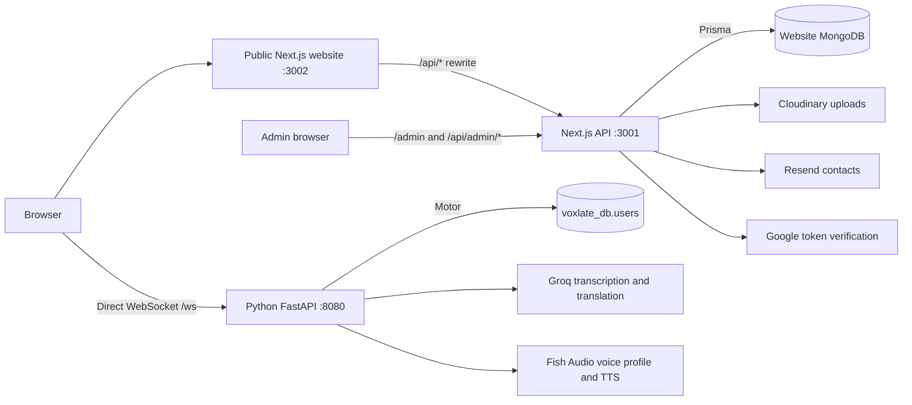
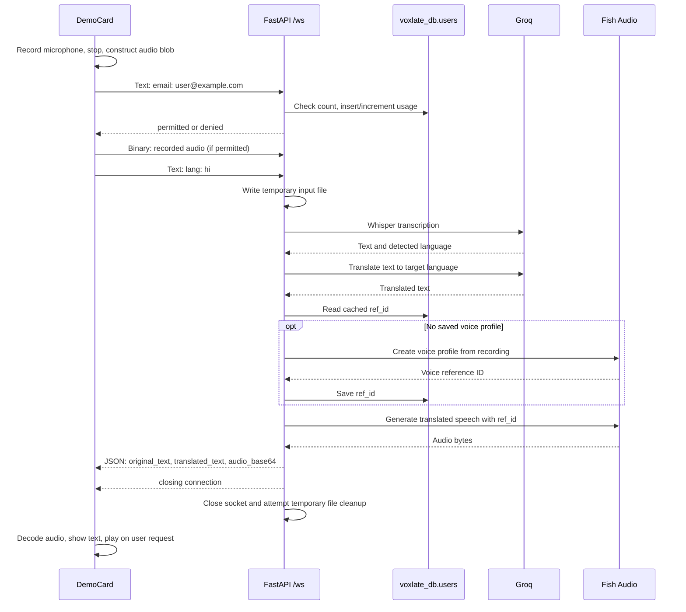

# Voxlate — project and API reference

Source review date: **11 October 2026**. This document describes the code in this checkout, including unfinished integrations. It is a maintenance reference, not confirmation that the deployed services have passed end-to-end testing.

Voxlate presents an AI speech-translation product intended to preserve a speaker's voice across languages. This repository contains the public product website, account and waitlist features, a recorded-audio translation demo, reviews, careers applications, and an admin dashboard. The digital and physical product pages describe the product vision; this checkout does not contain device firmware or meeting-platform integrations.

## Contents

- [Architecture and entry points](#architecture-and-entry-points)
- [Pages and source map](#pages-and-source-map)
- [Setup and environment](#setup-and-environment)
- [API reference](#api-reference)
- [Website request pipelines](#website-request-pipelines)
- [Speech translation pipeline and WebSocket protocol](#speech-translation-pipeline-and-websocket-protocol)
- [External service calls](#external-service-calls)
- [Data storage](#data-storage)
- [Operational behavior](#operational-behavior)
- [Current gaps and maintenance tracker](#current-gaps-and-maintenance-tracker)
- [Verification and update checklist](#verification-and-update-checklist)

## Architecture and entry points

There is no single executable main file. Three applications work together:

| Part | Location relative to this README | Main entry point | Development port |
| --- | --- | --- | --- |
| Public Next.js website | `./` | `app/layout.tsx`, `app/page.tsx` | `3002` |
| Next.js API and admin application | `Voxlate-waitlist-backend/Voxlate-Waitlist-Website/` | `app/api/**/route.ts`, `proxy.ts`, `app/admin/page.tsx` | `3001` |
| Python speech service | Backend's `demo/` directory | `connector_stream.py`, FastAPI `app` | `8080` when started with the command below |

In the sections below, **frontend** means this directory and **backend** means `Voxlate-waitlist-backend/Voxlate-Waitlist-Website/`. Python paths are relative to the backend. The backend also contains an older copy of the public UI; edits there do not update the outer website.



### Request routing

- Most frontend callers use relative `/api/...` URLs. [next.config.ts](next.config.ts) forwards these requests to `${NEXT_PUBLIC_API_BASE_URL}/api/...`, falling back to `http://localhost:3001`.
- The Google hook is an exception: [hooks/useGoogleSignIn.ts](hooks/useGoogleSignIn.ts) calls `${NEXT_PUBLIC_API_BASE_URL}/api/auth/google` directly with credentials. When the base is a different origin, CORS and cookie settings matter.
- Speech requests go directly from the browser to `NEXT_PUBLIC_WS_URL`; they do not pass through the Next.js API rewrite.
- `/admin` is a backend page. The frontend rewrites `/api/*` only, so visit the backend's `/admin/login` to use the dashboard.
- Frontend [tsconfig.json](tsconfig.json) excludes the nested backend, and [.vercelignore](.vercelignore) excludes it from the frontend upload. These are separate installations and deployments, not one combined server.

### Technology recorded in the manifests

Both JavaScript applications declare Node.js `>=22.0.0`, Next.js `^16.2.11`, React `^19.2.0`, TypeScript `^5.9.2`, and Tailwind CSS `^4.3.1`. Forms use React Hook Form and Zod; the outer website also uses Framer Motion. The backend uses Prisma with MongoDB, bcryptjs, jose, google-auth-library, Cloudinary, and Resend. Its manifests declare `@prisma/client ^6.19.3` and `prisma ^6.5.0`; use the respective lockfiles for resolved versions.

The speech service uses FastAPI, Uvicorn, Motor, Groq, Fish Audio, and dotenv. Its [requirements.txt](Voxlate-waitlist-backend/Voxlate-Waitlist-Website/demo/requirements.txt) has unpinned dependencies and no declared Python version.

## Pages and source map

### Public website

| Route | File | Purpose |
| --- | --- | --- |
| `/` | [app/page.tsx](app/page.tsx) | Hero, trust strip, product introduction, product cards, early tester invitation, FAQ |
| `/digital-version` | [app/digital-version/page.tsx](app/digital-version/page.tsx) | Digital product description, use cases, platform illustrations, waitlist CTA |
| `/physical-version` | [app/physical-version/page.tsx](app/physical-version/page.tsx) | Wearable product description, communication modes, use cases |
| `/demo` | [app/demo/page.tsx](app/demo/page.tsx), [DemoPageClient.tsx](app/demo/DemoPageClient.tsx) | Microphone demo and reviews; route declares `force-dynamic` |
| `/signup` | [SignupForm.tsx](app/signup/SignupForm.tsx) | Account creation, optional photo and waitlist opt-in |
| `/login` | [LoginForm.tsx](app/login/LoginForm.tsx) | Password sign-in |
| `/waitlist` | [app/waitlist/page.tsx](app/waitlist/page.tsx) | Public member directory with pagination |
| `/careers` | [app/careers/page.tsx](app/careers/page.tsx) | Application form and PDF resume upload |
| `/about` | [app/about/page.tsx](app/about/page.tsx) | Project/team information |
| `/privacy`, `/terms` | [Privacy](app/privacy/page.tsx), [Terms](app/terms/page.tsx) | Policy pages |

[app/layout.tsx](app/layout.tsx) loads fonts, global CSS, metadata, and the Google Identity script. Its providers wrap the UI in this order: `AuthProvider → AuthPromptProvider → PageTransitionProvider → WaitlistModalProvider`. Global waitlist, authentication prompt, and transition overlays are mounted here.

### Files to change for each feature

| Feature | Frontend source | Backend source, relative to backend root |
| --- | --- | --- |
| Password authentication | `lib/authApi.ts`, `lib/authValidation.ts`, `app/login/`, `app/signup/` | `app/api/auth/`, `lib/auth.ts`, `lib/session.ts` |
| Session restoration and UI sign-out | `components/auth/AuthProvider.tsx`, `components/layout/Navbar.tsx` | `app/api/auth/me/route.ts`, `app/api/auth/logout/route.ts` |
| Google sign-in scaffolding | `hooks/useGoogleSignIn.ts`, `components/auth/SocialAuthButton.tsx` | `app/api/auth/google/route.ts` |
| Waitlist form and directory | `components/waitlist/`, `lib/waitlistApi.ts`, `lib/validation.ts`, `app/waitlist/` | `app/api/waitlist/`, `lib/validation.ts` |
| Demo access gate | `components/auth/useDemoGate.ts` | Waitlist membership lookup; speech service has a separate usage check |
| Audio recording and playback | `components/sections/digital/DemoCard.tsx` | `demo/connector_stream.py`, `demo/transcribe_stt.py`, `demo/translate.py`, `demo/voice_clone_tts.py` |
| Profile uploads | `lib/uploadApi.ts`, signup, waitlist, navbar | `app/api/upload/route.ts`, `app/api/auth/me/route.ts` |
| Reviews | `components/sections/digital/ReviewBanner.tsx` | `app/api/reviews/route.ts` |
| Careers | `app/careers/page.tsx` | `app/api/upload/resume/route.ts`, `app/api/careers/apply/route.ts` |
| Admin dashboard | Visit backend `/admin` | `app/admin/`, `components/admin/AdminDashboard.tsx`, `app/api/admin/` |
| Schema and initial admin | — | `prisma/schema.prisma`, `prisma/seed.ts` |
| Headers, limits, logging | — | `proxy.ts`, `lib/cors.ts`, `lib/securityHeaders.ts`, `lib/rateLimiter.ts`, `lib/logger.ts` |

## Setup and environment

These commands describe how to start the applications. **Local authentication needs the cookie-domain correction listed below before browser sessions work on localhost.** Database/provider credentials and reachable services are also required. This documentation change has not installed packages or contacted those services.

### 1. Configure the backend

From the directory containing this README:

```bash
cd Voxlate-waitlist-backend/Voxlate-Waitlist-Website
cp .env.example .env
# Edit .env with your own development database and provider settings.
```

For the CLI and seed script, explicitly load your trusted local environment file in Bash. `prisma/seed.ts` reads `process.env` and does not explicitly load `.env.local`.

```bash
set -a
source .env
set +a
npm ci
npm run db:push
npm run db:seed
npm run dev
```

`db:push` changes the configured database schema/indexes; `db:seed` creates or promotes an admin in that database. Point these at the intended development database. Seeding an existing admin does not reset its password; seeding an existing non-admin promotes it without changing its password.

Backend API: `http://localhost:3001/api/...`. Admin: `http://localhost:3001/admin/login`.

| Backend variable | Purpose / current behavior |
| --- | --- |
| `DATABASE_URL` | MongoDB connection string used by Prisma. Choose the website database in the URI. Required by startup validation. |
| `JWT_SECRET` | JWT signing key; code requires at least 16 characters. Generate a strong random value, for example with `openssl rand -base64 32`. |
| `GOOGLE_CLIENT_ID` | Audience for Google ID-token verification. Currently required by startup validation even if the Google UI is unused. |
| `NEXT_PUBLIC_FRONTEND_URL` | Comma-separated CORS allowlist. Example: `http://localhost:3002`. If missing, code falls back to `http://localhost:3000`. |
| `CLOUDINARY_CLOUD_NAME`, `CLOUDINARY_API_KEY`, `CLOUDINARY_API_SECRET` | Image and resume uploads. |
| `RESEND_API_KEY` | Resend client/contact integration. Contact creation is conditional, but the client is constructed at module scope; do not assume removing the key cleanly disables the imported integration. |
| `ADMIN_NAME`, `ADMIN_EMAIL`, `ADMIN_PASSWORD` | Initial admin seed; name defaults to `Admin`, password must have at least 8 characters. Use a lowercase email to match normal login normalization. |
| `PORT` | Example file says `3001`; development script explicitly selects `3001`. Production `start` has no hardcoded port. |
| `NEXT_PUBLIC_API_BASE_URL` | Read by the backend's duplicated UI API helpers; defaults to an empty string there. Not required for the outer frontend's server rewrite configuration. |

### 2. Configure the public frontend

In another terminal, from the directory containing this README:

```bash
cp .env.example .env.local
# Edit .env.local and add NEXT_PUBLIC_WS_URL for the demo.
npm ci
npm run dev
```

Open `http://localhost:3002`.

```dotenv
PORT=3002
NEXT_PUBLIC_API_BASE_URL="http://localhost:3001"
NEXT_PUBLIC_GOOGLE_CLIENT_ID="your-google-client-id"
NEXT_PUBLIC_WS_URL="ws://localhost:8080/ws"
```

`NEXT_PUBLIC_WS_URL` is used by the code but missing from the checked-in frontend `.env.example`. Google client IDs must match the backend audience configuration. Values prefixed `NEXT_PUBLIC_` are public configuration: never place provider secrets in them. Restart/rebuild the frontend after changing its environment configuration.

### 3. Configure the speech service

From the directory containing this README, in a third terminal:

```bash
cd Voxlate-waitlist-backend/Voxlate-Waitlist-Website/demo
python3 -m venv .venv
source .venv/bin/activate
python -m pip install -r requirements.txt
# Create demo/.env with DATABASE_URL, GROQ_API_KEY, and FISH_API_KEY.
python -m uvicorn connector_stream:app --host 0.0.0.0 --port 8080
```

The speech service calls `load_dotenv()`; give it its own environment configuration or explicitly export its variables.

| Speech variable | Purpose |
| --- | --- |
| `DATABASE_URL` | Motor connection string; the code always selects database `voxlate_db` afterward, regardless of the URI's database name. |
| `GROQ_API_KEY` | Used for both transcription and translation. |
| `FISH_API_KEY` | Expected by the Fish Audio client for voice profile creation and speech generation. |

`GET http://localhost:8080/ping` returns `{"message":"Server is awake"}`. This checks process responsiveness only; it does not test MongoDB or either AI provider. There is no scheduled ping job configured in this checkout.

### Scripts and deployment boundaries

| Command | Frontend | Backend |
| --- | --- | --- |
| `npm run dev` | Next dev with Turbopack, port 3002 | Next dev with Turbopack, port 3001 |
| `npm run build` | `next build` | `next build` |
| `npm run start` | `next start` | `next start` |
| `npm run lint` | `eslint .` | `eslint .` |
| `npm run format` | `prettier --write .` | `prettier --write .` |
| `npm run db:generate` | — | Generate Prisma client; also runs after package installation |
| `npm run db:push` | — | Apply Prisma schema to configured MongoDB |
| `npm run db:studio` | — | Open Prisma Studio |
| `npm run db:seed` | — | Run `tsx prisma/seed.ts` |

For production, deploy the two Next.js applications with their respective project roots and configure a separate host for the persistent Python WebSocket process. Configure HTTPS frontend/backend URLs and a `wss://.../ws` speech URL. The backend build does not automatically run `db:push` or `db:seed`. The Python process needs a writable working directory for temporary audio. The old nested backend README contains historical ports and middleware names; use this source-derived reference for the combined checkout.

## API reference

All paths below are served by the backend's [app/api](Voxlate-waitlist-backend/Voxlate-Waitlist-Website/app/api) directory. They can also be reached through the frontend `/api/*` rewrite. JSON bodies use `Content-Type: application/json`, except the multipart resume upload. Access labels describe checks in the handlers, not just frontend UI gates.

### Authentication and profiles

| Method | Endpoint | Access | Request | Success / important failures |
| --- | --- | --- | --- | --- |
| POST | `/api/auth/signup` | Public | `{name,email,password,agreedToTerms:true,photo?}` | `201`, `{status,message,data:{id,name,email,photoUrl}}`, session cookie. `400` validation, `409 email_taken`, `429` rate limit. Name 1–120 characters; password at least 8. |
| POST | `/api/auth/login` | Public | `{email,password}` | `200`, same user fields and session cookie. `400` validation, `401 invalid_credentials`, `429`. |
| POST | `/api/auth/google` | Public | `{idToken}` | `200`, `{status,message,data:{id,name,email}}`, session cookie. `400` missing token, `401` missing required token payload, `429`; verification exceptions fall into `500 server_error`. |
| GET | `/api/auth/me` | Session | No body | `200`, `{status,data:{id,email,name,role,photoUrl?}}`; `401` without a valid session. Identity/role come from JWT; photo is queried from the user record. |
| PATCH | `/api/auth/me` | Session | `{photo?:string}` | `200`, `{status,message,data:{id,name,email,photoUrl?}}`; empty/omitted photo clears stored photo. `400` format errors, `401` unauthenticated. |
| POST | `/api/auth/logout` | No valid session required | No body | `200`, `{status:"success",message:"Signed out."}`; expires the session cookie. |

For signup/profile updates, a photo may be a `data:image/...` string or a string starting with `http`. Normal frontend flows upload the data URL first and then send the resulting hosted URL. Signup's `confirmPassword` and `joinWaitlist` are frontend concerns; `agreedToTerms` is required by the backend but is not persisted as a consent record.

### Waitlist, uploads, reviews, and careers

| Method | Endpoint | Access | Request | Success / important behavior |
| --- | --- | --- | --- | --- |
| GET | `/api/waitlist?email=...` | Public | Email query | `{status:"success",data:{joined:boolean}}`; email lookup takes precedence over listing. |
| GET | `/api/waitlist?page=1&pageSize=20` | Public | Page and size | `{status,data:[...],pagination:{page,pageSize,total,totalPages}}`; defaults 1/20, maximum size 50, newest first. Public fields: `id,name,role,organization,photoUrl,createdAt,type,product`. |
| POST | `/api/waitlist` | Public; UI prompts for login | Waitlist body below | `201`, `{status,message,data:{id,email,position}}`; `400` validation, `409 duplicate_email`. Also attempts Resend contact sync. |
| POST | `/api/waitlist/sync-photo` | Public | `{email,photo?}` | `200`, `{status,message}`. Fills an existing entry's missing photo only. Missing entry or existing photo is a successful no-op. |
| POST | `/api/upload` | Public | `{photo:"data:image/...;base64,..."}` | `200`, `{status:"success",data:{url}}`; Cloudinary profile image. `400` missing/invalid photo, `429` limit, `500 upload_error`. No server-side 10 MB limit in this handler. |
| POST | `/api/upload/resume` | Public | Multipart field `resume` | `200`, `{status:"success",data:{url}}`; Cloudinary PDF. Requires MIME `application/pdf`, size at most `10 * 1024 * 1024` bytes. `400`, `429`, or `500 upload_error`. |
| GET | `/api/reviews` | Public | No body | `{status:"success",reviews:[...]}`, all reviews newest first; includes `userEmail`. No API pagination. |
| POST | `/api/reviews` | Session optional | `{text,rating,authorName?,authorPhotoUrl?,userEmail?}` | `201`, `{status:"success",review:{...}}`; nonempty text, numeric rating from 1 to 5, and author name required. Session can supply missing name/email. Database rating field is an integer. |
| POST | `/api/careers/apply` | Public | Career body below | `200`, `{status:"success",data:{id}}`; `400` missing required values, `500 server_error`. Stores application with default status `Pending`. |

**Waitlist request:**

```json
{
  "name": "Example User",
  "email": "person@example.com",
  "type": "individual",
  "product": "digital",
  "company": "Example Organization",
  "role": "Student",
  "organization": "Example Organization",
  "source": "signup",
  "photo": "https://example.com/profile.jpg"
}
```

Required: `name` (1–120 characters), valid `email`, `type` (`individual|business`), `product` (`digital|physical|both`). Other fields are optional. `company` and `organization` each allow 200 characters; `role` allows 120. Email is lowercased and trimmed before insertion. `position` is a count of entries created at or before the new entry's timestamp, not a stored permanent queue number.

**Career request:**

```json
{
  "fullName": "Example Applicant",
  "email": "applicant@example.com",
  "contactNumber": "example contact number",
  "college": "Example College",
  "currentYear": "3rd Year",
  "roleAppliedFor": "Tech (Full-Stack / Backend / Frontend)",
  "strongestSkills": "TypeScript and Python",
  "motivation": "Why I want to join",
  "projectDetails": "Optional project description",
  "proposedIdea": "My proposed idea",
  "uniqueEdge": "What I can contribute",
  "portfolioLinks": "https://example.com/portfolio",
  "resumeUrl": "https://example.com/resume.pdf"
}
```

All shown fields except `projectDetails` and `portfolioLinks` are required. The handler checks presence rather than a complete Zod schema; it does not normalize the career email or validate that the resume URL came from the upload endpoint.

### Admin endpoints

All require a valid session with JWT role `ADMIN`; otherwise handlers return `403`. Admin page protection relies on `proxy.ts`; `app/admin/page.tsx` reads the session for the display name but does not independently enforce the role. Source: [app/api/admin](Voxlate-waitlist-backend/Voxlate-Waitlist-Website/app/api/admin).

| Method | Endpoint | Request | Result / side effect |
| --- | --- | --- | --- |
| GET | `/api/admin/stats` | None | `{status,data:{totalWaitlist,totalUsers,newLast7Days,totalApplications,byProduct,byType}}`. `newLast7Days` counts **users**, not waitlist entries. |
| GET | `/api/admin/waitlist` | `page,pageSize,search,product,type` | Paginated full waitlist records. Case-insensitive search across name/email/company using OR; product/type filters support valid enum values. |
| DELETE | `/api/admin/waitlist?id=...` | Entry ID | Deletes one database entry; `{status,message}`. `400` missing ID, `404` absent record; no corresponding Cloudinary/Resend deletion. |
| GET | `/api/admin/waitlist/export` | `page,pageSize` | CSV attachment, newest first. Columns: Name, Email, Company, Type, Product, Source, Joined At. Maximum 500 rows per requested page; does not apply dashboard search/product/type filters. |
| GET | `/api/admin/users` | `page,pageSize,search` | Paginated `id,name,email,role,createdAt`; name/email OR search, no password hashes returned. |
| PATCH | `/api/admin/users` | `{id,role:"USER"|"ADMIN"}` | Updates role and returns `{status,data:{id,name,email,role}}`. Cannot demote the current session's own user; `400` invalid request, `404` missing user. |
| GET | `/api/admin/applications` | `page,pageSize,search` | Paginated full applications. Current search requires a match in **all three** of full name, email, and college (AND). |
| POST | `/api/admin/cleanup` | No body | Deletes expired or used password-reset tokens; `{status:"success",data:{deleted:number}}`. Not wired to a scheduled job or dashboard button. |

Always pass explicit `page` and `pageSize` to admin lists/exports. Current code uses `Number(searchParams.get(...))`; an omitted value becomes `0` and is clamped to `1`, so the effective omitted page size is **1**, despite the apparent fallback of 25 (or 100 for CSV). The dashboard export link omits these parameters and therefore currently exports just one row. List maximum is 100; export maximum is 500. Validating integer query values is also outstanding.

### Response conventions and preflight

Most handlers use `status:"success"` plus `data`, or `status:"error"` plus `message`, optional `code`, and optional field `errors`. Reviews use `review`/`reviews` instead of `data`; CSV is not JSON. Do not assume every route failure has a structured body: some database reads are outside a catch block.

Most route files explicitly implement `OPTIONS` returning `204` with CORS/security headers. `/api/upload/resume` and `/api/careers/apply` have no explicit `OPTIONS` export and rely on the backend proxy's API preflight branch. Check that behavior when changing the proxy configuration.

## Website request pipelines

### 1. Account creation and optional waitlist join

1. `SignupForm` validates fields, matching passwords, and checked terms with React Hook Form/Zod.
2. If a new image was selected, `uploadPhoto()` sends `POST /api/upload`; Cloudinary returns a hosted URL. An upload failure stops signup.
3. `signupUser()` sends `POST /api/auth/signup`, including `agreedToTerms`. The backend validates, applies the signup limit, normalizes email, hashes the password with bcrypt cost 12, and creates `User`.
4. The backend signs a JWT and attaches `voxlate_session`; the frontend updates `AuthProvider` state.
5. If `joinWaitlist` is checked, a separate `POST /api/waitlist` uses `type:"individual"`, `product:"digital"`, and `source:"signup"`.
6. The page shows account success and redirects to `redirectTo` (default `/`). The optional waitlist response is currently ignored, so account success does not establish that the waitlist join succeeded.

### 2. Login, restore, Google, and logout

- **Password login:** `LoginForm → loginUser → POST /api/auth/login → MongoDB user lookup → bcrypt comparison → JWT cookie → AuthProvider.login → redirectTo`.
- **Restore after refresh:** `AuthProvider` calls `GET /api/auth/me` with credentials on mount and rebuilds browser state from the response.
- **Google implementation:** Google Identity script returns a credential → hook sends `{idToken}` → backend verifies against `GOOGLE_CLIENT_ID` → finds or creates a user → sets cookie → browser reloads. New Google users receive a generated password hash; the handler does not persist Google's photo. `SocialAuthButton` and the hook exist, but the outer login/signup forms currently do not render the button.
- **Logout API:** `POST /api/auth/logout` expires the cookie. The backend admin UI calls it. The outer website's `AuthProvider.logout()` currently only clears React state, so refreshing can restore the still-valid session.

### 3. Waitlist join, public directory, and demo unlock

1. `useGatedWaitlist` opens either the authentication prompt or waitlist modal based on browser auth state.
2. Opening the modal checks `GET /api/waitlist?email=...`.
3. For an existing member with a profile photo, `POST /api/waitlist/sync-photo` can fill a missing waitlist photo.
4. For a new member, optional image upload runs first, followed by `POST /api/waitlist`.
5. Backend stores `WaitlistEntry`, optionally calls `resend.contacts.create`, then calculates position. Contact-sync exceptions are logged without rolling back the entry. No welcome email is sent here.
6. A successful join or duplicate-email response dispatches browser event `waitlist:joined`; `useDemoGate` checks membership again.
7. `/waitlist` separately calls `getPublicWaitlist(page,20)`. The helper converts HTTP/network failures to a success-shaped empty list; an empty directory can therefore mean an API failure.

`WaitlistModalProvider` stores the CTA's `source`, but the current form initializes its own source to an empty string and does not copy the provider source. The visible organization input writes `company`, while the public directory receives the separate `organization` field.

### 4. Profile photo update

`Navbar image selection → FileReader data URL → POST /api/upload → Cloudinary URL → PATCH /api/auth/me {photo:url} → User.photoUrl → AuthProvider.updatePhoto`.

This does not update an existing waitlist photo. The modal's separate sync request only fills an empty waitlist photo, so the two records can diverge after a profile change.

### 5. Reviews

`ReviewBanner mount → GET /api/reviews → browser sorts by rating descending, then recency → carousel`.

Submission sends `POST /api/reviews` with text/rating and, when signed in, name/photo/email from auth state. The backend stores a `Review`, and the browser inserts it into the sorted list. `review:open-form` opens the form. The handler accepts caller-supplied identity and does not require demo completion or membership.

### 6. Careers

`Careers form → multipart POST /api/upload/resume → Cloudinary raw PDF → POST /api/careers/apply with resumeUrl → JobApplication → success screen`.

UI field mapping: `phone→contactNumber`, `year→currentYear`, `role→roleAppliedFor`, `skills→strongestSkills`, `project→projectDetails`, `ideas→proposedIdea`, `differentiator→uniqueEdge`, `links→portfolioLinks`. An application failure after upload can leave an unreferenced file in Cloudinary; there is no rollback call.

### 7. Admin dashboard

`/admin/login → POST /api/auth/login → GET /api/auth/me → role check → /admin`.

The dashboard loads counts through `/api/admin/stats`, waitlist records through `/api/admin/waitlist`, users through `/api/admin/users`, and applications through `/api/admin/applications`. It supports waitlist deletion, CSV download, user promotion/demotion, and viewing application details. Application status is stored but there is no status-update API in this checkout. Non-admin login is followed by logout. The proxy and server helpers check the role stored in the JWT rather than reloading the database role on every request.

## Speech translation pipeline and WebSocket protocol

Main implementation: [DemoCard.tsx](components/sections/digital/DemoCard.tsx) and [connector_stream.py](Voxlate-waitlist-backend/Voxlate-Waitlist-Website/demo/connector_stream.py).

The implemented demo records a complete utterance and processes it after the user stops recording. It is not continuous bidirectional streaming translation: the server returns one JSON result containing the complete audio payload.



### Exact frame order

| Direction | Frame type | Contents |
| --- | --- | --- |
| Client → server | Text | `email: person@example.com` |
| Server → client | Text | `permitted` or `denied` |
| Client → server, if permitted | Binary | Entire recorded audio blob |
| Client → server, after binary frame | Text | `lang: hi` (or selected language code) |
| Server → client, success | JSON text | `{"status":"success","original_text":"...","translated_text":"...","audio_base64":"..."}` |
| Server → client, processing failure | Text | `error` |
| Server → client, end | Text | `closing connection`, then socket close |

The client explicitly ignores non-JSON control messages when parsing the result. Audio is decoded into a browser `Blob` labeled `audio/wav` and assigned an object URL for playback.

### Processing stages

| Stage | Function / file | Action |
| --- | --- | --- |
| Gate in browser | `useDemoGate.ts` | Requires auth state and a successful waitlist membership lookup before recording. |
| Capture | `DemoCard.startRecording/stopRecording` | `getUserMedia({audio:true})` and `MediaRecorder`; after stop, packages data as `audio/webm`. Stops microphone tracks. |
| Usage check | `connector_stream.websocket_endpoint` | Accepts supplied email, strips spaces/lowercases it, checks `count` in `voxlate_db.users`. A new email starts at 1; counts at least 5 are denied. |
| Temporary input | `connector_stream.py` | Writes `<email>_<uuid>.webm` in the working directory. |
| Speech to text | `transcribe_stt.transcribe_audio_groq` | `Groq.audio.transcriptions.create`, model `whisper-large-v3-turbo`, temperature `0.0`, `verbose_json`. Returns text and detected language. |
| Translation | `translate.translate_text_groq` | `Groq.chat.completions.create`, model `openai/gpt-oss-120b`, temperature `0.3`; system prompt asks for translated text only. Detected STT language is not otherwise used. |
| First-use voice profile | `voice_clone_tts.onboard_user_voice` | `FishAudio.voices.create` uploads the input recording. Stores returned ID as `ref_id`; later requests reuse it. |
| Speech synthesis | `voice_clone_tts.generate_live_tts` | `FishAudio.tts.convert`, model `s2.1-pro-free`, `reference_id=ref_id`, `latency="balanced"`. Writes `<email>_<uuid>.output.wav`. |
| Return and cleanup | `connector_stream.py` | Reads output, base64-encodes it, sends JSON, closes socket; `finally` attempts to remove input/output files. Blocking file/provider operations run through `asyncio.to_thread`. |

Available UI targets: English `en`, Spanish `es`, French `fr`, German `de`, Bengali `bn`, Tamil `ta`, Hindi `hi` (default), Japanese `ja`, Chinese `zh`, Arabic `ar`. Marketing copy about larger language coverage is not a tested support matrix for this demo.

The five-attempt counter increments **before** audio processing and has no reset interval. Failed processing can consume an attempt. The check/increment is not atomic. The WebSocket service does not verify the JWT, authenticate the supplied email, or query the website waitlist; its gate is separate from the browser gate.

`demo/App.jsx` is an older React client using `import.meta.env.VITE_WS_URL` (default `ws://localhost:8080/ws`). It is not the component rendered by the outer Next.js demo, and this checkout does not provide a separate Vite package/configuration to run it as a standalone app. It expects binary response audio rather than the current JSON/base64 result and still displays a three-request limit; it needs updating before reuse with the current service.

## External service calls

These are the SDK operations and remote resources referenced by the code. Provider HTTP endpoints are encapsulated by SDKs; this list does not assume undocumented provider URLs.

| Service | Caller | Operation and data sent | Stored/returned result |
| --- | --- | --- | --- |
| Google Identity | Frontend layout and Google hook | Loads `https://accounts.google.com/gsi/client`; Google credential is posted to backend | Backend verifies with `OAuth2Client.verifyIdToken`; account/session |
| Cloudinary images | Backend `/api/upload` | `uploader.upload_stream`, image bytes, folder `voxlate/profiles`, resource type `image` | `secure_url` returned to client; later saved on user/waitlist records |
| Cloudinary resumes | Backend `/api/upload/resume` | `uploader.upload_stream`, PDF bytes, folder `voxlate/resumes`, resource type `raw`, format `pdf` | `secure_url` saved by the application submission |
| Resend contacts | Backend `/api/waitlist` | `contacts.create({email,firstName})` after insertion | No contact ID stored; does not send a welcome email |
| Groq STT | Python `transcribe_stt.py` | Recorded audio bytes | Transcript and language |
| Groq translation | Python `translate.py` | Transcript and target-language instruction | Translated text |
| Fish Audio voice creation | Python `voice_clone_tts.py` | First recording, title, description | Saved voice ID in demo MongoDB |
| Fish Audio TTS | Python `voice_clone_tts.py` | Translated text and saved voice ID | Speech bytes |
| MongoDB | Prisma backend and Motor speech service | Website records and separate demo counters/reference IDs | Persistent data described below |
| Vimeo embed | `components/waitlist/TutorialModal.tsx`, opened from Hero | Iframe at `https://player.vimeo.com/video/1231178393` with player parameters | Tutorial video; no application API handler |
| Google font | Frontend `app/layout.tsx` | `next/font/google` configures Inter | Font handled by Next.js |

## Data storage

Website schema: [prisma/schema.prisma](Voxlate-waitlist-backend/Voxlate-Waitlist-Website/prisma/schema.prisma). Models use MongoDB ObjectId-backed IDs and have no declared relations between users, waitlist entries, reviews, or applications; email is the application-level connection where used.

| Model / collection | Main fields | Constraints / lifecycle |
| --- | --- | --- |
| `User` / `users` | `id,name,email,password,role,photoUrl,createdAt,updatedAt` | Unique email; password is a bcrypt hash; default role `USER`. |
| `WaitlistEntry` / `waitlist_entries` | `id,name,email,company,type,product,source,role,organization,photoUrl,createdAt` | Unique email, index on createdAt; `role` here is profession, not authorization role. |
| `Review` / `reviews` | `id,authorName,authorPhotoUrl,userEmail,text,rating,createdAt` | Integer rating; index on createdAt. No uniqueness, user relation, or moderation field. |
| `JobApplication` / `job_applications` | Career fields above, `status,createdAt,updatedAt` | Default `Pending`; no unique email constraint. |
| `PasswordResetToken` / `password_reset_tokens` | `id,email,token,expiresAt,createdAt,usedAt` | Unique token; cleanup handler exists, creation/consumption routes do not. |

The Python service separately selects **`voxlate_db.users`** with documents containing `email`, `count`, and `ref_id`. This structure is different from Prisma's website `User`. Do not assume pointing both services at the same URI connects website membership to demo access; if the website database is also named `voxlate_db`, the two different user document shapes can collide in the same collection.

Cloudinary stores uploaded files; MongoDB stores URLs. Temporary speech input/output files are local and removed on a best-effort basis after each socket run. The code does not delete Fish Audio voice profiles, provider-held data, Cloudinary uploads, or Resend contacts during that cleanup.

## Operational behavior

- **Session:** `voxlate_session`, HS256 JWT, seven-day expiry, `httpOnly`, `sameSite:lax`, path `/`. Both setting and clearing the cookie currently hardcode `secure:true` and `domain:".voxlatesn.in"` in backend `lib/auth.ts`.
- **Admin authorization:** `proxy.ts` protects admin pages/APIs, and API handlers separately call `requireAdmin()` to check the JWT. The admin page itself only reads the session for display. Role changes in MongoDB do not revoke or refresh existing JWTs; an old role can remain valid until a new session or expiry.
- **Rate limits:** per-process in-memory map keyed by client IP: signup 3/minute, password login 5/minute, Google login 5/minute, uploads 10/minute. Image and resume uploads share `upload:<ip>`. These limits are not coordinated across instances and reset when the process restarts. Most other public endpoints do not use this limiter.
- **Timeouts:** frontend auth/waitlist helpers use 10 seconds; image upload and each careers request use 30 seconds. Session restore, Google, reviews, and admin calls have no explicit timeout. The speech client has no explicit connection/processing timeout or `onerror` recovery handler.
- **Headers:** backend helpers provide CORS, `X-Correlation-ID` on many responses, security headers, and credential support. Header application is not uniform across every branch. The configured CSP includes `connect-src 'self'`; Permissions-Policy disables microphone/camera. Review document-level header behavior before reusing these headers on the frontend demo.
- **Logs:** auth routes append newline-delimited JSON to backend `logs/auth.log`; entries can include email, IP, user agent, event and correlation ID. File-write errors are swallowed, so this is not durable centralized logging on ephemeral/read-only hosts. Speech/provider errors go to process output.
- **Startup validation:** `proxy.ts` calls `validateStartup()`, which requires database URL, JWT secret, and Google client ID. Upload/AI provider credentials are exercised later when their features run.

## Current gaps and maintenance tracker

Unchecked items below are observed code behavior or unfinished wiring, not completed fixes. They are included so future work can be tracked against the implementation.

| Status | Area | Follow-up and source |
| --- | --- | --- |
| [ ] | Local/preview authentication | Make cookie domain and secure behavior environment-aware in backend `lib/auth.ts`. `.voxlatesn.in` cannot establish a normal localhost or unrelated-preview-domain session. |
| [ ] | Website logout | Connect outer `AuthProvider.logout()` to `POST /api/auth/logout`; current sign-out only changes React state. |
| [ ] | Demo authorization and quota | Authenticate `/ws`, check membership server-side, and make quota updates atomic. Current caller-supplied email is not proof of identity and failed attempts consume quota. |
| [ ] | Demo storage | Deliberately separate/configure `voxlate_db.users` versus website Prisma `users`; current database name is hardcoded. |
| [ ] | Demo reliability | Add socket error/timeout recovery, verify MediaRecorder output MIME on supported browsers, verify the Fish output encoding rather than relying only on a `.wav` suffix, and release replaced object URLs. |
| [ ] | Google UI | Wire the existing social button into the intended forms. Verify direct-origin cookies/CORS and remove credential-token console logging from the hook. |
| [ ] | Admin pagination/export | Correct omitted-query-number defaults; export currently receives no page size from its dashboard link and returns one row. Decide whether export should honor filters/all pages. |
| [ ] | Admin applications search | Decide whether name/email/college search should be OR; current handler uses AND. |
| [ ] | Role freshness | Revalidate current roles or invalidate sessions after promotion/demotion. Existing JWT roles remain unchanged. |
| [ ] | Public write identity | Waitlist/photo-sync/uploads/careers and review identity checks differ from their UI gates. Define and enforce the intended server-side access rules. |
| [ ] | Public review data | `GET /api/reviews` includes email; review submission accepts supplied author identity. Decide which fields should be public and which must come from a verified session. |
| [ ] | Waitlist field wiring | Pass CTA source into the modal payload and reconcile `company` versus `organization`. Decide whether profile changes should replace waitlist photos. |
| [ ] | Signup feedback | Handle optional waitlist join failures separately from successful account creation. |
| [ ] | Empty-directory fallback | Make `getPublicWaitlist()` distinguish network/server failure from a real empty waitlist. |
| [ ] | Proxy configuration | Backend exports `proxyConfig` for its matcher; verify the framework-recognized configuration export and actual matching in a build. |
| [ ] | Deployment configuration | Add speech URL to the frontend example environment; verify Resend startup without a key, durable logs, CORS on all branches, and document-level microphone/WebSocket headers. |
| [ ] | Navigation | Demo footer points Privacy Policy to `/terms` and Contact Us to `/contact`; no `/contact` page exists in the outer route tree. |
| [ ] | Automated verification | Neither package defines a test script, and no application test suite was found in this checkout. Add focused coverage for auth, API contracts, and the speech protocol as those areas change. |

## Verification and update checklist

This README was checked against local source files, API handler exports, environment references, and request call sites. Live database access, provider availability, builds, and browser journeys were **not** verified as part of writing it.

After functional changes, use a development environment to check:

1. Run `npm run lint` and `npm run build` separately in the frontend and backend directories.
2. Confirm a logged-out `/api/auth/me` returns 401 and admin endpoints return 403.
3. Exercise signup/login, refresh-based restoration, profile upload, and real cookie-clearing logout after fixing local cookie configuration.
4. Join the waitlist, retry a duplicate, check public pagination and demo unlock, and distinguish API failure from an empty directory.
5. Upload a valid PDF and submit a career application; verify the record in the admin dashboard.
6. Check reviews, role changes, explicit admin pagination, and a CSV export with the expected row count.
7. Check `/ping`, then run one short authorized demo recording with configured providers. Verify both text fields, audible playback, saved `ref_id`, count behavior, and temporary file cleanup. This invokes paid/external services and consumes a demo attempt.

When changing an endpoint, update its method/path, caller, request fields, response, access check, side effects and failure behavior here. When changing speech models or framing, update both the provider table and WebSocket protocol. When changing the schema or deployment, update database/environment tables and the tracker.

| Date | Documentation change |
| --- | --- |
| 2026-10-11 | Initial combined source-based architecture, API catalog, request pipelines, setup, data map, and maintenance tracker. |
