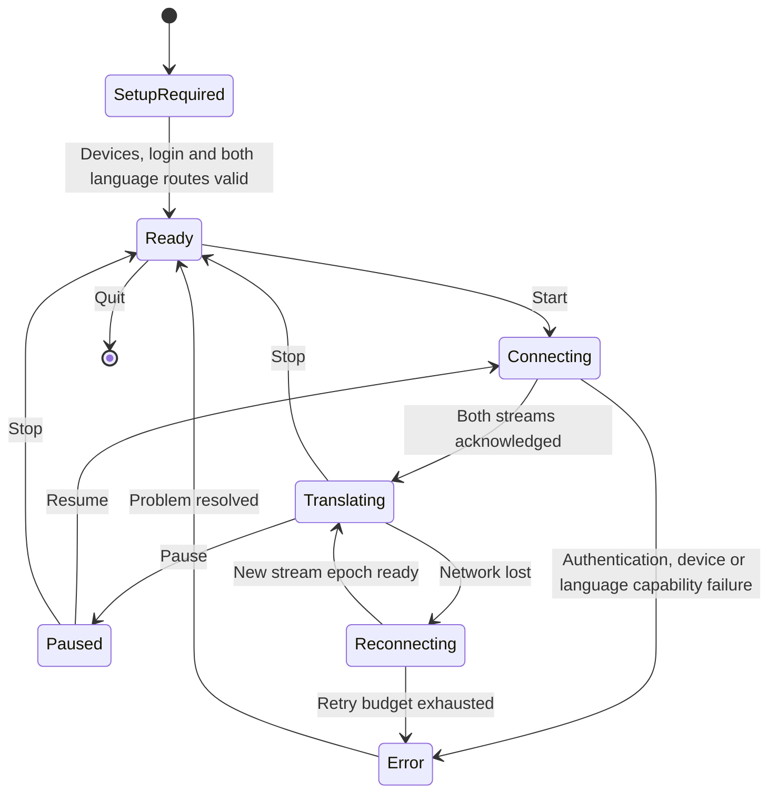

# Voxlate · Windows desktop app

**C++ application plan · Indian languages ↔ English · Two-way audio · Updated 12 October 2026**

[Backend pipeline](PIPELINE.md) · [Current project reference](README.md)

> A small Windows app where you choose your real microphone and headphones, set **My language** and **Meeting language**, and start translation. In the meeting app, choose **Voxlate Microphone** and **Voxlate Speaker**. Voxlate remains available in the system tray while audio processing runs independently of the window.

This is a proposed implementation and layout based on the supplied hand-drawn sketch. It is not a finished visual design or an existing C++ application. The current repository contains a Next.js website and Python recorded-audio demo; native audio routing, installer, driver, and desktop source still need to be built.

The [original layout sketch](Voxlate-Waitlist-Website/docs/assets/windows-layout-reference.png) is preserved with these documents for future design work.

## 1. Product behavior

The first development pilot is **Hindi ↔ English, both ways**. The expanded roadmap also includes **Bengali, Tamil, Telugu, Marathi, Gujarati, Kannada, Malayalam, Punjabi, Odia, Assamese and Urdu ↔ English**, following the capability and model-readiness rules in [PIPELINE.md](PIPELINE.md#indian-language-expansion). None is claimed as implemented or benchmarked yet.

The Hindi/English pilot works as follows:

- You speak Hindi into your physical microphone; the meeting receives generated English through Voxlate Microphone.
- Others speak English; the meeting sends that audio to Voxlate Speaker; you hear generated Hindi through your chosen physical output.
- Choosing English as your language and Hindi as the meeting language reverses both paths.
- Background operation means a normal, visible tray application with clear state, pause, mute and quit controls. It does not need antivirus-level privileges or an always-running privileged audio service.

Aim for natural conversation with dependable routing and low measured delay. The app cannot guarantee undetectable translation, exact voice identity, or video lip synchronization. C++ helps control local audio buffers and CPU use; it cannot eliminate the time needed to understand and translate speech.

### Language selection and availability

Both **My language** and **Meeting language** use the same language catalog, filtered by the server's directional capabilities. Selecting a pair sets outgoing translation from My language to Meeting language, and incoming translation in the reverse direction. English remains available; the app must no longer assume the only alternative to Hindi is English.

| Language | App tag | Initial script | Roadmap status |
| --- | --- | --- | --- |
| English | `en` | Latin | Pilot counterpart; validation pending |
| Hindi | `hi` | Devanagari | Pilot; validation pending |
| Bengali (Bangla) | `bn` | Bengali | Planned expansion |
| Tamil | `ta` | Tamil | Planned expansion |
| Telugu | `te` | Telugu | Planned expansion |
| Marathi | `mr` | Devanagari | Planned expansion |
| Gujarati | `gu` | Gujarati | Planned expansion |
| Kannada | `kn` | Kannada | Planned expansion |
| Malayalam | `ml` | Malayalam | Planned expansion |
| Punjabi | `pa-Guru` | Gurmukhi | Planned expansion; this script variant only |
| Odia | `or` | Odia | Planned expansion |
| Assamese | `as` | Assamese | Planned expansion |
| Urdu | `ur` | Perso-Arabic | Planned expansion; right-to-left text |

These tags identify app preferences, not model-specific IDs. The server maps them to its adapters. A saved language selection is not evidence that its ASR, translation or voice is ready.

- Fetch `GET /v1/capabilities` after login and before session creation. Display deployment-specific availability; let the server validate the requested pair again when starting.
- Label choices **Available**, **Experimental** or **Planned** using the server's `validated`, `experimental` or `planned` state. Experimental routes require an explicit test-mode choice. Planned routes cannot start translation.
- Enable two-way Start only when source ASR, translation and target speech output are ready for **both** directions. If one direction is unavailable, show its reason beside the pair. Do not silently enter one-way mode.
- Keep the selected language visible when unavailable. Never substitute Hindi or English automatically. Caption-only experiments must be a separately selected mode, clearly labelled as such.
- Enable **Use my voice** only when the outgoing target language supports the selected profile/converter. Generic speech can still work when cloning is unavailable; show the reason and retain generic mode.
- Evaluate English pairs first. Indian-language pairs such as Tamil ↔ Hindi remain unavailable until that exact pair passes both directions; English support alone does not establish direct pair support.

The current model plan has a target-language voice gap for the additional Indian languages, documented in the pipeline. Show that limitation as a capability reason rather than offering a language choice that produces no speech. Adding a dropdown item does not enable model support.

Use Unicode strings throughout the C++/Qt UI and protocol. Preserve the chosen script in captions and test phrases; support font fallback, combining marks and Urdu right-to-left text without reversing device names or technical IDs. Display-language localization is a separate feature: selecting Tamil for translation does not automatically translate the entire app interface.

## 2. Simple layout preview

The sketch's microphone/speaker selectors, language selector, voice-cloning switch, power switch, installation screen and small tray panel are retained. **Meeting language** is added because one language selector does not define two-way translation.


This saved preview shows the original Hindi/English pilot layout only. It does not demonstrate the expanded language catalog, capture audio or connect to a backend. The native implementation must add the server-driven language choices, availability labels, audio-test and voice-enrollment flows described here. The main-window and tray examples below show a future validated pilot session; today's implementation is still pending.

### Main window

```text
┌──────────────────────────────────────────────────────┐
│  VOXLATE                              Settings  —  × │
│  Hindi ↔ English                         [ Start ]  │
│                                                      │
│  My microphone                                       │
│  [ USB Headset Microphone                         ▾ ]│
│                                                      │
│  I hear audio through                                │
│  [ USB Headphones                                 ▾ ]│
│                                                      │
│  My language              Meeting language           │
│  [ Hindi              ▾ ] [ English               ▾ ]│
│                                                      │
│  Use my voice                              [ Off ]   │
│  Generic voice selected · Set up my voice            │
│                                                      │
│  YOU → MEETING   Hindi → English                     │
│  MEETING → YOU   English → Hindi                     │
│                                                      │
│  Ready · Meeting device setup                        │
│  [ Mute my input ] [ Audio test ] [ Hide to tray ]    │
└──────────────────────────────────────────────────────┘
```

Device dropdowns show **physical** devices. The virtual devices are selected inside the meeting app, not as the user's physical microphone/output. This distinction prevents feedback loops.

### Expanded-language availability preview

```text
My language                  Meeting language
[ Tamil                  ▾ ] [ English              ▾ ]

YOU → MEETING   Tamil → English    Evaluation pending
MEETING → YOU   English → Tamil    Tamil voice unavailable

Two-way speech is not ready for this pair.
[ Start — disabled ]   [ View language availability ]
```

This is an illustrative planned state, not a live server result. The availability panel lists all roadmap languages and the exact missing stage for the selected pair. Show a concise user-facing reason such as “Tamil voice is not available yet”; keep model IDs and diagnostic details in troubleshooting. Searchable dropdowns should match English language names and any supplied localized names, with keyboard and screen-reader support.

### Installation and first run

```text
┌──────────────────────────────────────────────┐
│  Welcome to Voxlate                          │
│  Choose your language and meeting language. │
│                                              │
│  [ ] I accept the terms and privacy policy  │
│                                              │
│  Virtual audio devices will be installed.   │
│  Windows may request administrator approval.│
│                                  [ Next ]   │
└──────────────────────────────────────────────┘

Next steps: Sign in → Load language availability → Choose devices → Set languages
            → Optional voice setup → Test → Meeting setup
```

Show the actual product terms/privacy links and a separate explanation/choice for reusable voice enrollment. Declining voice enrollment must still allow generic-voice translation. Start muted/off until the user completes setup and explicitly starts.

### Tray popup

```text
┌──────────────────────────────────────┐
│  Voxlate · Translating               │
│  Hindi ↔ English                    │
│                                      │
│  [ Pause ]     [ Mute my input ]      │
│  Mic: USB Headset                    │
│  Output: USB Headphones              │
│                                      │
│  [ Open Voxlate ]          [ Quit ]  │
└──────────────────────────────────────┘
                  ▲
            Windows tray icon
```

Keep the main device/language editing in the full window. The tray is for quick state and control, not a second competing settings interface. Main window and tray must use one shared state model.

Derive the tray pair label from the active acknowledged session, not from a draft dropdown selection. Accommodate longer names and scripts without truncating the direction or hiding an error. If a saved pair becomes unavailable, show “Language pair unavailable” and an Open Voxlate action; do not display Translating.

## 3. The essential routing design

### What the user selects

| Location | Setting | Selection |
| --- | --- | --- |
| Voxlate | My microphone | A real microphone, e.g. USB Headset Microphone |
| Voxlate | I hear audio through | Real headphones/speakers |
| Voxlate | My language | A ready source language; Hindi in the pilot example |
| Voxlate | Meeting language | A ready counterpart; English in the pilot example |
| Meeting app | Microphone/input | **Voxlate Microphone** |
| Meeting app | Speaker/output | **Voxlate Speaker** |

Use endpoint IDs internally, not friendly names or list positions. Names can change or be duplicated. Provide a setup screen that explains these settings for each supported meeting client without silently changing system-wide defaults.

### Full signal flow


**Voxlate Microphone** must appear to other programs as a capture/recording endpoint, but Voxlate must also have a way to feed PCM into it. **Voxlate Speaker** must appear as a render/playback endpoint, with a way for Voxlate to read the rendered samples. A WASAPI capture handle alone does not let an application inject audio into arbitrary microphones.

### Two implementation routes

| Route | Appropriate use | Work required |
| --- | --- | --- |
| Two separately installed virtual cable pairs | First developer proof and private routing tests | App writes outgoing TTS to cable A's render side; meeting reads its capture side. Meeting writes to cable B's render side; app reads its capture side. Keep the pairs separate. |
| Product-owned/licensed virtual audio driver | Branded production endpoints and controlled installer | Expose the intended endpoint topology, implement transport/clocking/bridge, device lifecycle and signed packaging. This is a separate engineering deliverable. |

For a lab, a vendor such as VB-Audio provides virtual cables; installation, multiple-cable availability and redistribution rights must follow the vendor's terms. Do not assume a free download grants rebranding or bundling rights. [Vendor source](https://vb-audio.com/Cable/).

Microsoft's **SysVAD** is a virtual audio driver development sample, not a finished Voxlate audio cable. It can inform the endpoint/driver work, but the real bridge between app-produced PCM and the exposed capture endpoint still needs design, implementation and testing. Keep networking and model inference out of the kernel driver. [Microsoft sample](https://github.com/microsoft/Windows-driver-samples/blob/main/audio/sysvad/README.md).

For an isolated Voxlate render endpoint, WASAPI loopback can capture its rendered audio. General physical-speaker loopback captures other applications too and risks recapturing Voxlate playback. Process-specific loopback is another option for supported Windows builds, but it is not a universal replacement for both virtual endpoints or guaranteed process targeting across all meeting clients. [Loopback recording](https://learn.microsoft.com/en-us/windows/win32/coreaudio/loopback-recording), [application capture sample](https://learn.microsoft.com/en-us/samples/microsoft/windows-classic-samples/applicationloopbackaudio-sample/).

### Loop prevention rules

1. Outgoing input is only the selected real microphone. Never choose Voxlate Microphone as its own source.
2. Incoming input is only the meeting's isolated virtual playback path. Never capture translated physical output as incoming source.
3. Send outgoing TTS only to the virtual microphone; send incoming TTS only to the physical output.
4. Do not enable Windows “Listen to this device” or a parallel raw-monitor path that duplicates audio.
5. Recommend headphones during initial release/testing. Physical speakers require acoustic echo cancellation with the actual locally rendered signal as reference.
6. Meeting-app echo cancellation may have a different reference signal from Voxlate's locally rendered translated speech. Test the combined system; do not assume the meeting app will remove all echo.

## 4. C++ technology and process design

**Recommended starting point:** C++20, CMake, Qt 6 Widgets for the compact UI/tray, and direct Windows Core Audio/WASAPI for routing. Use Python/GPU services on the backend as described in the pipeline. Native desktop code and optimized model runtimes can coexist.

| Component | Choice / responsibility |
| --- | --- |
| UI | Qt Widgets; device/language controls, setup, readable states, keyboard navigation |
| Tray | `QSystemTrayIcon`, popup/menu actions, single shared controller |
| Device inventory | `IMMDeviceEnumerator`, endpoint IDs, `IMMNotificationClient` notifications |
| Audio capture/render | Event-driven WASAPI shared mode, `IAudioClient`/`IAudioClient3` where supported, capture/render clients |
| Buffers | Preallocated single-producer/single-consumer queues where topology permits; explicit bounds and discontinuity markers |
| Resampling | One tested resampler adapter; separate analysis and output format conversion |
| Transport | Dedicated Qt Network/WebSockets worker; TLS verification, binary framing and bounded queues |
| Language catalog | Server capabilities, stable language/script tags, pair validation and target-voice readiness |
| Optional local VAD | ONNX Runtime/Silero adapter after routing is stable |
| Configuration | `QSettings` for nonsecret preferences; OS-protected credential storage for tokens |
| Logs | Rotating structured logs with IDs/timing; no raw audio, transcript or access token by default |
| Distribution | Signed user-mode app/installer plus separately signed and tested driver package |

Qt has commercial/open-source licensing options with module-specific obligations; choose the applicable route and inventory the actual shipped modules. Widgets are sufficient for the sketch; Qt Quick can be evaluated later if the final design needs it. [Qt licensing](https://doc.qt.io/qt-6/licensing.html), [tray API](https://doc.qt.io/qt-6/qsystemtrayicon.html).

### Threads and ownership

```text
UI thread
  AppController + settings + main window + tray
                 │ commands / snapshots
                 ▼
Session coordinator
  Outgoing state ───────────────── Incoming state
     │                                  │
WASAPI capture worker             Virtual speaker capture worker
     │ bounded audio queue              │ bounded audio queue
Network worker / outgoing WSS     Network worker / incoming WSS
     │ decoded output queue             │ decoded output queue
Virtual microphone render         Physical output render
```

The drawing specifies ownership, not a requirement to spawn exactly one OS thread for every box. Capture/render callbacks must not wait for the UI, disk, DNS, TLS, network, logging, model inference or a contended mutex. Preallocate buffers; handle underrun by intentional silence, not stale samples. Use RAII for COM/audio handles, `std::jthread`/stop tokens or equivalent controlled worker lifetimes, and explicit shutdown ordering.

WASAPI periods depend on hardware/driver support. Request supported low-latency shared-mode periods, inspect the actual result, and keep the meeting compatible with other audio users. Use appropriate audio scheduling rather than setting the entire process to real-time priority. [Microsoft low-latency guidance](https://learn.microsoft.com/en-us/windows-hardware/drivers/audio/low-latency-audio).

Do not confuse the 200 ms network experiment with an audio callback that wakes only every 200 ms. Small local callbacks can feed larger network batches without delaying local mute, device handling or playback.

## 5. State machine and background behavior



Window visibility is independent of translation state: hiding a window does not stop the engine. Direction-specific errors can be displayed without pretending both lanes are healthy.

| Control/state | Proposed behavior |
| --- | --- |
| Start / power switch | Authenticate, revalidate both language routes and audio formats, warm session, then begin streaming. Show connecting until both directions acknowledge readiness. |
| Change language pair | Validate the draft selection without changing the active call. On Apply, stop uploads, cancel queued speech and begin a new session/epoch only after both new routes are acknowledged. A rejected draft leaves the current pair unchanged; a failed applied change pauses with a clear error. |
| Pause | Stop translation/capture upload, cancel queued synthesized audio. Incoming original audio passes through locally; outgoing mic is **muted by default**. State this beside the control. |
| “Use original mic” bypass | Separate explicit action if the user wants untranslated speech sent to the meeting. Never silently enable it after a failure. |
| Mute my input | Immediate local silence at virtual mic, stop outgoing upload and invalidate pending outgoing speech. Incoming translation may continue. |
| Voice cloning off | Use the chosen generic outgoing voice; no new reference collection. Apply changes at phrase boundaries. |
| Voice cloning on | Check target-language cloning capability and the user's ready, authorized profile; offer enrollment only for supported routes, keeping a valid generic voice active until ready. |
| Close window | Hide to tray, with a one-time explanation. It is not Quit. |
| Quit | Stop capture/upload, cancel playback, close streams, release audio devices and exit. With meeting devices still set to Voxlate, audio may stop; provide explicit instructions to switch back. |
| Start with Windows | Optional, user-controlled startup of the tray app. Do not begin capturing/uploading merely because Windows started. |
| Sleep / lock / resume | Close/suspend streams according to selected privacy policy; after resume re-enumerate devices and require a clear valid state before capture resumes. |

**Meeting mute is not Voxlate mute.** Muting the meeting's input can stop others hearing virtual-mic audio while Voxlate still captures/processes the physical mic. Explain this in setup and provide a prominent app-level mute that controls upload. Standard virtual-device routing does not expose every meeting client's mute state.

A normal per-user process can stay in the tray while its window is closed. Avoid a Windows Service for microphone/UI control in the first version; services run outside the interactive user's normal session. A narrowly scoped installer/helper may need elevation for driver tasks; the everyday app should not run as administrator.

## 6. Audio and session contracts

Use the versioned endpoint/event design in [PIPELINE.md](PIPELINE.md#7-session-protocol-and-service-architecture). It is a new backend capability, not the current `/ws` protocol.

### Desktop requirements

- Authenticate through a browser-based desktop login/token exchange designed for the app; if OAuth/OIDC is adopted, use a public-client flow with PKCE. The current website has no such authorization-server flow yet.
- Store refresh credentials in protected Windows storage. Obtain short-lived session/stream tokens; never ship Groq/Fish/Cloudinary/server secrets in the executable.
- Load `/v1/capabilities` and validate each directional route's language/script, ASR, translation and TTS readiness. Treat cached catalog data as display information until the server revalidates it; cloning readiness is a separate optional capability.
- Keep one WSS connection per direction initially. Include protocol version, sequence, epoch, sample timestamps and negotiated formats.
- Receive binary audio blocks with segment IDs; route solely by trusted stream/session metadata, not arbitrary device names from the server.
- Convert model output to the chosen device's actual format and channel count in a worker. Stereo device output can receive dual-mono speech; do not assume all devices accept 24 kHz mono.
- Maintain bounded jitter/playback queues. Report audible delay and last played sample/segment, not just bytes received.
- On cancellation or reconnect, reject old-epoch audio from both server and local queues. Retry controls safely; do not replay speech that was already audible.
- Keep language/profile changes versioned. Apply them at safe boundaries or cancel the old segment before starting a new epoch.
- Handle `unsupported_language_pair` with the unavailable direction and reason. Cancel setup without uploading speech or selecting an alternative language automatically.

### Clocking matters

Physical microphone, physical output and virtual endpoints may have independent clocks. Count samples and use monotonic timestamps. Long calls need drift monitoring and controlled resampling/queue adjustment. A buffer that slowly grows for 30 minutes can sound fine during a ten-second demo and still be unusable in production.

For a virtual-microphone input, meetings expect a continuous audio timeline. While no translated phrase is available, supply valid silence at the negotiated cadence rather than repeatedly reopening the device. Keep phrase sequence correct as blocks arrive.

## 7. Step-by-step development plan

### Step 1 — Freeze the smallest working scope

Support Windows 11 x64 initially, one logged-in user, one meeting app at a time, Hindi/English as the first audio pilot, two directions, physical headset and generic voice. Build the language catalog for all 12 planned Indian languages plus English from the start; enable routes only as backend evaluations pass. Choose the first meeting clients to test; Zoom, Teams and browser-based Meet are separate compatibility targets, not assumed supported because a device appears.

**Done when:** the endpoint naming, routing diagram, pause/mute policy and new session contract are agreed. UI colors and decorative design can remain undecided.

### Step 2 — Set up a reproducible Windows build

Install an MSVC C++ toolchain, matching Windows SDK, CMake/Ninja and a Qt 6 MSVC x64 kit. Pin versions in the project manifest/presets. Use the SDK/WDK combination required by the selected driver branch for driver work; do not assume app and driver share one build target.

Proposed directory structure:

```text
desktop/windows/                      New directory to implement
  CMakeLists.txt
  CMakePresets.json
  src/
    main.cpp
    app/AppController.*
    audio/DeviceManager.*
    audio/WasapiCapture.*
    audio/WasapiRender.*
    audio/AudioRouter.*
    audio/RingBuffer.*
    audio/Resampler.*
    network/SessionClient.*
    network/LanguageCapabilities.*
    network/AudioStream.*
    protocol/Frames.*
    ui/MainWindow.*
    ui/SetupWizard.*
    ui/TrayController.*
    storage/Settings.*
    storage/CredentialStore.*
  tests/
  installer/
  resources/
  third_party/                         Notices/manifests, not copied secrets
drivers/voxlate-audio/                 Separate driver project if selected
```

Minimal **illustrative** CMake starting point after implementing the named source files:

```cmake
cmake_minimum_required(VERSION 3.24)
project(Voxlate LANGUAGES CXX)
set(CMAKE_CXX_STANDARD 20)
set(CMAKE_CXX_STANDARD_REQUIRED ON)
set(CMAKE_AUTOMOC ON)
find_package(Qt6 REQUIRED COMPONENTS Widgets Network WebSockets)
qt_add_executable(Voxlate WIN32
    src/main.cpp
    src/app/AppController.cpp
    src/audio/DeviceManager.cpp
    src/audio/WasapiCapture.cpp
    src/audio/WasapiRender.cpp
    src/ui/MainWindow.cpp
    src/ui/TrayController.cpp
    src/network/SessionClient.cpp
)
target_link_libraries(Voxlate PRIVATE
    Qt6::Widgets Qt6::Network Qt6::WebSockets
    ole32 uuid avrt propsys
)
target_compile_definitions(Voxlate PRIVATE UNICODE _UNICODE NOMINMAX)
```

This snippet does not implement audio bridging, credentials, resampling or an installer. Add each implemented module and its actual dependencies explicitly. Build commands below are a future recipe, not commands that work against today's website checkout.

### Step 3 — Build a local audio probe before connecting AI

Enumerate active capture/render endpoints, display IDs/names, record a short consented test to memory, and play it only on the selected output. Implement device notifications, mic permission errors, format negotiation and deterministic cleanup. Microsoft's capture/render examples show the relevant WASAPI interfaces. [Capture](https://learn.microsoft.com/en-us/windows/win32/coreaudio/capturing-a-stream), [render](https://learn.microsoft.com/en-us/windows/win32/coreaudio/rendering-a-stream).

**Done when:** mic capture and physical playback work for the supported devices, repeated start/stop does not leak resources, and no hot-path operation depends on UI responsiveness.

### Step 4 — Prove virtual routing with no models

Use two approved lab cable pairs or an initial driver bridge. Feed a known test sound into the outgoing virtual mic and receive a known meeting sound through the incoming virtual speaker. Test paths independently before joining them. Exclude virtual endpoints from physical-device dropdowns.

**Done when:** a remote tester hears exactly the outgoing test signal; the local user hears only the intended incoming signal; silence stays silent; neither path recaptures the other's output. This small proof should happen while backend models are being evaluated, before final UI work.

### Step 5 — Add a fake backend and protocol tests

Create a test server that accepts timestamped chunks and returns known PCM with adjustable delay, gaps and errors. It should implement the same proposed framing as the real service. Include capability fixtures for ready Hindi/English, planned Tamil, a one-direction-only route, missing cloning and a stale catalog rejected at session creation. Test binary parser bounds, sequence continuity, queue limits, cancellation and reconnection without incurring model cost.

**Done when:** pausing, muting and reconnecting never replay a cancelled phrase; a malformed frame cannot crash the audio engine; old-epoch audio is discarded.

### Step 6 — Connect the tested generic-voice pipeline

Only after backend model evaluation, connect Hindi→English outgoing and English→Hindi incoming streams. Record stage timings and actual local playback times. Show separate states for each direction; avoid a green global “connected” badge when one direction is failing.

**Done when:** a sustained two-person conversation works with no loop or unbounded backlog and known Hindi/English sentences preserve meaning. Measure both directions active concurrently.

### Step 6a — Expand languages as backend routes become ready

Use the same session interfaces for Bengali, Tamil, Telugu, Marathi, Gujarati, Kannada, Malayalam, Punjabi, Odia, Assamese and Urdu. For each new English pair, first verify transcript/script handling, then translation and speech playback in both directions. Keep a route planned if any required model stage is missing. Test direct Indian-language pairs as separate capabilities later.

**Done when:** each enabled pair has native-listener evidence, measured two-way delay, working target-language voices and a recorded backend revision. The UI must correctly display unavailable and experimental pairs before broader speech support ships.

### Step 7 — Add the sketch-based UI and tray

Build the layout above with readable native controls. Bind it to `AppController`; UI changes issue commands, and controller snapshots update both window and tray. Close-to-tray should preserve processing, while Quit actually stops it. Show real states rather than simulated latency values.

**Done when:** devices, languages, Start/Pause, input mute and tray all work by keyboard; hiding/reopening the window does not reset a call. The final art direction can be decided after these behaviors are usable.

### Step 8 — Add enrolled voice as a separate feature

Offer a clean pre-call sample workflow, playback/re-record, clear storage choice, profile readiness and deletion. Only the chosen profile ID reaches the session request; provider secrets and raw database credentials stay server-side. Keep generic speech available if profile readiness fails.

**Done when:** a returning user can use cached conditioning without re-enrollment, and toggling the feature never switches voice in the middle of a word/phrase. Live tone-color interpolation remains outside this milestone.

### Step 9 — Harden Windows behavior

Test USB unplug/replug, Bluetooth profile changes, device rename/default change, audio service restart, screen lock, sleep/resume, network change, proxy/TLS errors, server restart, simultaneous speech, and meeting-client noise suppression/AGC. Never automatically switch to a different private microphone without telling the user.

Bluetooth headsets may change input/output capability when the microphone is activated. Re-negotiate the actual format instead of assuming the previous output mode survives. Document support based on measured devices.

**Done when:** recovery is deterministic and each failure has a clear state and safe output behavior.

### Step 10 — Package the app and driver correctly

Build the user-mode application in Release. Use Qt deployment tooling to gather the matching runtime/plugins; test on a clean VM with no developer tools. Include dependency notices and required runtimes. Sign the executable/installer. [Qt Windows deployment](https://doc.qt.io/qt-6/windows-deployment.html).

The virtual audio driver is separate: implement and test it, produce its INF/catalog package, and follow Microsoft's current driver-signing route. Current Microsoft guidance recommends HLK-tested dashboard signing for production and describes attestation as a testing path; do not promise an unsigned/custom kernel driver will load on retail Secure Boot machines. [Signing options](https://learn.microsoft.com/en-us/windows-hardware/drivers/dashboard/driver-signing-offerings), [policy](https://learn.microsoft.com/en-us/windows-hardware/drivers/install/kernel-mode-code-signing-policy--windows-vista-and-later-).

Install driver changes through an explicit elevated installer action. The normal app returns to standard-user operation. Coordinate app/driver protocol versions and provide rollback. Do not update or remove a driver during an active call; schedule the change after stopping audio.

**Done when:** install, upgrade, rollback and uninstall work on clean supported Windows systems, endpoints appear reliably, and the package does not ask users to weaken Windows security settings.

## 8. Illustrative build and deploy commands

After the proposed C++ sources and CMake file exist, use a suitable MSVC developer shell. Replace the Qt path with the installed matching kit:

```powershell
cmake -S desktop/windows -B build/windows -G Ninja `
  -DCMAKE_BUILD_TYPE=Release `
  -DCMAKE_PREFIX_PATH="C:/Qt/<version>/msvc2022_64"

cmake --build build/windows --config Release

# Once tests are registered through CMake/CTest:
ctest --test-dir build/windows -C Release --output-on-failure

& "C:/Qt/<version>/msvc2022_64/bin/windeployqt.exe" `
  --release "build/windows/Voxlate.exe"
```

These commands package the user-mode application only. They do not build/sign/install the driver, create an installer, configure OAuth or start the Python server. Add CI builds and tests after the source tree exists; validate the selected kit/toolchain rather than using the placeholder as a literal path.

## 9. Failure and fallback contract

| Failure | Outgoing behavior | Incoming behavior | User sees |
| --- | --- | --- | --- |
| Network/backend unavailable | Mute virtual mic; do not unexpectedly transmit original voice | Pass original meeting audio locally if app/routing still works | Reconnecting / translation unavailable |
| User pauses translation | Muted unless explicit original-mic bypass chosen | Original meeting audio | Paused · outgoing muted |
| Physical mic removed | Cancel pending outgoing speech, output silence | Continue if output remains usable | Choose a microphone |
| Physical output removed | Outgoing may continue only if clearly shown | Stop output; do not automatically play private audio on laptop speakers | Choose an output |
| TTS/profile error | Use a permitted generic voice in the requested target language at a new boundary or remain muted | Same-language generic voice if available; show text as a visibly degraded state | Voice unavailable / generic voice / audio unavailable |
| Language pair rejected at setup | Do not start upload or outgoing speech | Do not start a partial two-way translation session | Unavailable direction and reason; choose another pair |
| Active language route becomes unavailable | Cancel affected queued speech and pause the two-way session; do not substitute another language | Original-audio passthrough under the existing pause policy, clearly labelled | Translation paused · language route unavailable |
| Audio queue exceeds limit | Stop/drop according to explicit cancellation policy, never duplicate | Same | Translation delayed; pause/restart or skip option |
| App exits/crashes | Virtual endpoint may remain but should not emit stale speech | Meeting still targets virtual device and may become inaudible | On restart: recovery/setup instructions |

The generic cable prototype cannot promise crash-time automatic passthrough. A production driver's watchdog can define silence/disconnection behavior, but restoring arbitrary meeting device selections after a crash requires client-specific support or user action. Keep a “Switch meeting devices back” help path available.

## 10. Test and acceptance checklist

### Audio integrity

- [ ] Both directions work separately and together without routing loops.
- [ ] Output reaches only its intended destination; incoming speech is never injected into the meeting mic.
- [ ] Silence, clicks, clipping, underruns and overruns are measured.
- [ ] Device clocks do not create growing buffers during a 30–60 minute call.
- [ ] Sample-rate/channel conversion works on the chosen USB, built-in and Bluetooth devices.
- [ ] Mic mute cancels already queued speech and stops outgoing uploads promptly.
- [ ] A disconnected/reconnected socket cannot replay old translated audio.

### Conversation quality

- [ ] Hindi, Indian English and Hinglish test cases include numbers, names and negation.
- [ ] Each enabled expansion language has separate results for both English directions, local accents, code-switching and target-language pronunciation.
- [ ] No pair is marked ready solely because ASR or text translation works; required speech output is also validated.
- [ ] Native listeners assess intelligibility and meaning, not only voice similarity.
- [ ] Speech-start delay, phrase-end delay and finish lag are reported with P50/P95/P99.
- [ ] No growing lag at the documented server concurrency.
- [ ] Generic/enrolled voice changes are clean at phrase boundaries.
- [ ] Original-versus-translated playback does not produce doubled local speech.

### Windows and usability

- [ ] Signed install/upgrade/uninstall on clean supported Windows machines.
- [ ] App runs as a standard user after installation.
- [ ] Main/tray state remains consistent; Close hides and Quit exits.
- [ ] Microphone privacy denial, unplug, sleep/resume and network changes are recoverable.
- [ ] Startup is opt-in and does not automatically upload microphone audio.
- [ ] Keyboard navigation, readable contrast and accessible labels work.
- [ ] All 12 Indian-language names and English are represented in the catalog with correct tags and availability states.
- [ ] Unicode captions, combining marks, long labels, Gurmukhi and Urdu right-to-left text render correctly.
- [ ] Stale capabilities, one-direction-only support and missing target voices cannot start a misleading two-way session.
- [ ] Changing languages cancels old-epoch speech and updates main/tray labels only after acknowledgement.
- [ ] No provider secrets in binaries or logs; tokens use protected storage.
- [ ] Voice-profile delete/re-enroll works across service caches.

### Compatibility record — fill from actual tests

| Meeting client / version | Windows build | Physical devices | Two-way route | Echo/AGC behavior | Long-call result | Notes |
| --- | --- | --- | --- | --- | --- | --- |
| Zoom | TBD | TBD | Not tested | Not tested | Not tested | — |
| Microsoft Teams | TBD | TBD | Not tested | Not tested | Not tested | — |
| Google Meet + browser version | TBD | TBD | Not tested | Not tested | Not tested | — |

## 11. Recommended delivery milestones

| Milestone | Deliverable | Exit condition |
| --- | --- | --- |
| A · Routing proof | Small C++ test harness and two lab cable pairs | Clean bidirectional paths without AI |
| B · Backend benchmark | Model results from [PIPELINE.md](PIPELINE.md#10-first-evaluation-sprint) | Known Hindi/English quality, latency and resource limits |
| B1 · Language catalog | Server-driven catalog for 12 Indian languages and English | Accurate planned/experimental/available states and rejection of incomplete routes |
| C · Functional alpha | Generic-voice translation, simple window and tray | A sustained two-way call works with cancellation/recovery |
| D · Personal voice | Optional reusable enrollment | Returning users avoid re-enrollment and fallback is reliable |
| E · Product distribution | Production virtual audio solution and signed installer | Clean-machine install, driver stability and target client tests |
| F · Voice refinement | Speaker-aware incoming output and experimental adaptation | Measured benefit without worse meaning, identity stability or delay |
| G · Indian-language rollout | Additional English pairs, followed by separately tested Indian-language pairs | Each pair passes two-way speech, script, quality and latency gates; timing depends on target-language model readiness |

Do not estimate this as “only a small frontend.” The compact window is straightforward relative to models, but virtual audio, echo, device changes, continuous clocks, driver signing and safe recovery are substantial product work.

## 12. Open decisions

- Server hardware, region, expected simultaneous calls and cost budget.
- First supported Windows build range and meeting client priority.
- Lab cable provider versus licensed/owned production virtual audio driver.
- Generic voice preferences and optional enrollment retention settings.
- Expansion-language priority and the missing target-language TTS/adaptation decisions identified in the pipeline.
- Exact measured latency/quality release thresholds.
- Final UI styling; the layout above is the working structure only.

**First practical next step:** run the five-day model evaluation and build the small Windows routing probe. Use their results to commit to the production stack before investing in a polished interface or promising invisible translation.
