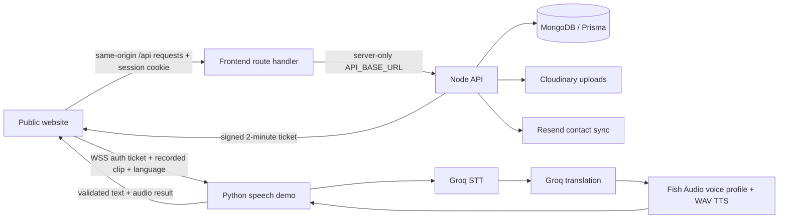

# Voxlate website audit

**Updated:** 12 October 2026 · **Scope:** the public website, its Node API, and the recorded-clip speech demo.

The redesign keeps Voxlate's original logo, product descriptions, page structure, waitlist, team, and language ribbon. “Less AI-looking” means making deliberate visual choices and removing repetitive decoration. It does not mean hiding that Voxlate uses AI for translation.

## Design research and decisions

[NN/g's visual-design principles](https://www.nngroup.com/articles/principles-visual-design/) support using hierarchy, proportion, contrast, and grouping to guide attention. [Its flat-design guidance](https://www.nngroup.com/articles/flat-design-best-practices/) also stresses keeping controls recognizable. Removing shadows should not make buttons, inputs, or links ambiguous.

[A public designer/agency discussion](https://www.reddit.com/r/agency/comments/1skbxo0/an_entitled_rant_about_homogenous_aigenerated/) criticizes interchangeable landing pages, repeated cards, generic imagery, and unnecessary surface effects. These are community opinions, not a reliable test of whether a website was generated with AI. The changes below apply those criticisms where they match this site's actual UI.

### What changed

| Pattern found in this website | Change |
| --- | --- |
| Large decorative shadows around UI panels, menus, and overlays | Removed; thin boundaries and spacing separate surfaces |
| Large rounded rectangles everywhere | Controls use a 4 px radius; panels generally use 6–8 px |
| Full-width header treatment competing with the page | Transparent sticky wrapper with a bounded white navigation cutout |
| A menu target shrinking on small screens | Fixed-size 44 px mobile menu target; proportional logo sizing at narrow widths |
| Several similar product cards stacked within sections | Open product rows, rules, lists, and specification tables |
| Generic scenes for digital and physical use cases | Removed those images; retained the original use-case labels and descriptions |
| Decorative curves behind meeting-app logos | Removed; the original platform examples remain plainly grouped |
| Pill-shaped status labels and decorative dots | Plain status text; the selected hover interaction remains on primary buttons |
| A crowded palette of nearly identical surfaces | One restrained blue, technical white, slate, and limited status colors |
| Reviews ranked with the highest ratings first | Recent reviews first, with actual ratings retained |
| Public review payloads containing email addresses | Public responses omit email; signed-in identity comes from the server session |
| Unprofessional signup photo label | Clear “Profile photo” label |
| Demo waits or errors that look like missing waitlist membership | Separate access-check failure and retry states |
| Long review text could force layout wider | Review text wraps safely |

Product concept renders and real team portraits remain because they describe the existing product/team. Concept imagery is explicitly labeled. No invented customer quotes, usage numbers, compatibility badges, or production screenshots were added.

### Shared visual system

| Token | Value | Use |
| --- | --- | --- |
| Primary | `#285A78` | Main actions, selected controls, translation ribbon |
| Primary hover | `#204860` | Hover/focus interaction |
| Page | `#F7F8FA` | Technical white background |
| Surface | `#FFFFFF` | Forms, app preview, navigation |
| Mist | `#EDF1F4` | Quiet section grouping |
| Ink | `#182B3A` | Main text |
| Slate | `#5A6872` | Supporting text |
| Rule | `#CCD6DE` | Dividers |
| Control boundary | `#7D8E99` | Inputs and secondary buttons |
| Success / error | `#1F7A4D` / `#B42318` | Actual system states |

DM Sans is the body/control font, Newsreader is the display font, and script-specific fonts support the ribbon. The original Inter wordmark remains. Serif emphasis is reserved for headings. Keyboard focus uses an outline, rather than an ambient glow.

The approved multilingual-to-English ribbon, oscillating waveform, typewriter, hover buttons, underline links, and scroll-fade selector remain. Reduced-motion and offscreen behavior remain available. The removed animation-pause control has not been reintroduced.

## Page coverage

| Page | Treatment |
| --- | --- |
| Home | Balanced responsive hero; cutout header; product preview; open product sections |
| Digital | Product-first preview; clear two-way explanation; divided use cases; restrained platform section |
| Physical | Existing concept device; text-based use cases; modes and specification table |
| Demo | Consistent selector; explicit recording/access/processing/result/error states; readable review list |
| About | Existing mission and team; shared typography and surfaces |
| Careers | Existing application sections; consistent controls; validated upload/submission contract |
| Login / signup | Quiet forms; same typography; safe redirect destinations |
| Waitlist | Real directory loading/error/empty states; shared actions |
| Privacy / terms | Readable document measure, shared navigation and typography |

### Reviews found

Public search found product mentions, but no detailed independent website usability reviews that could confidently be attributed to this Voxlate site. Similarly named products were excluded. The local reviews endpoint could not return stored feedback because the database configuration is a placeholder. General design criticism was not presented as customer feedback, and no testimonials were fabricated. Once the database is configured, review actual comments and prioritize repeated usability problems rather than selectively quoting praise.

## Frontend ↔ API connection



This implements a recorded-clip web demo. It does not establish the future desktop streaming pipeline, virtual audio driver, or live meeting compatibility.

### API contracts checked

| Frontend call | Backend behavior |
| --- | --- |
| `POST /api/auth/signup` | Validated account data; session cookie; signup result |
| `POST /api/auth/login` | Validated credentials; session cookie; user data |
| `POST /api/auth/google` | Google ID token verification; same-origin route; no browser credential logging |
| `GET /api/auth/me` | Validated session and current account data; 401 when absent |
| `PATCH /api/auth/me` | Authenticated profile update |
| `POST /api/auth/logout` | Expires session cookie; browser clears state after success |
| `GET /api/waitlist` | Paginated public directory or membership check; JSON outage state |
| `POST /api/waitlist` | Validated entry; explicit duplicate/validation/failure result |
| `POST /api/waitlist/sync-photo` | Requires the matching signed-in account |
| `GET /api/reviews` | Recent public reviews; no email addresses |
| `POST /api/reviews` | Bounded review text, integer rating, server-derived account identity |
| `POST /api/upload` | Validated image under 10 MB; Cloudinary URL |
| `POST /api/upload/resume` | PDF under 10 MB; multipart body forwarded intact |
| `POST /api/careers/apply` | Validated fields and HTTPS resume URL; confirmed result |
| `POST /api/demo/token` | Signed-in waitlisted user gets an expiring demo-only ticket |
| `GET /api/health` | Checks database readiness; 503 when not ready |

The proxy preserves status codes and separate `Set-Cookie` headers, forwards session/authorization and ingress IP headers, bounds uploads to 16 MiB, prevents direct self-proxy loops, and returns JSON for unavailable/slow upstream services. All API responses bypass caching. Browser calls have deadlines. Auth redirects remain inside the website.

The Node API uses a reusable Prisma client during development. Production session cookies default to host-only, which works with the frontend proxy and preview hosts. The former `.voxlatesn.in` cookie is expired when switching to host-only sessions. An explicit `SESSION_COOKIE_DOMAIN` remains available for intentional shared-subdomain sessions.

### Speech demo contract

1. Browser checks signed-in/waitlist access through the Node API.
2. Recording uses a browser-supported MIME type and stops at 60 seconds. Empty or oversized clips are rejected.
3. Browser requests a short-lived ticket, opens the configured WebSocket, and sends `auth: <ticket>`.
4. Server validates the signature, issuer, audience, expiry, identity, and allowed frontend origin.
5. Server sends `permitted`; browser sends one binary clip followed by `lang: <code>`.
6. Server validates the target, atomically reserves quota, processes STT → translation → voice → WAV, and returns one JSON result.
7. Server/client close the socket. Failures restore reserved quota; temporary local files are cleaned up. Browser cleanup releases tracks and audio URLs.

`denied`, `unauthorized`, service errors, disconnects, and timeouts have explicit states. A demo ticket cannot be used as a website session. All ten selector language codes match the server allowlist. This does not imply equal transcription/translation/voice quality across all targets; real language tests are still required.

**Deploy these changes together:** the legacy `email: ...` WebSocket identity is intentionally refused. `demo/App.jsx` is an old standalone prototype; the supported integration is the main website's `/demo` page.

## Configuration and release steps

### Frontend deployment

```dotenv
API_BASE_URL=https://your-node-api-host.example
API_TIMEOUT_MS=30000
NEXT_PUBLIC_WS_URL=wss://your-speech-host.example/ws
NEXT_PUBLIC_GOOGLE_CLIENT_ID=your-configured-client-id.apps.googleusercontent.com
```

`API_BASE_URL` is server-only. The old public API variable is accepted for migration, but new deployments should use the server-only setting. Production rejects an absent/loopback API URL and a missing/insecure/local speech URL. `ALLOW_LOCAL_API_IN_PRODUCTION=1` exists only for explicit local production smoke testing; omit it in deployment.

Public variables are set at build time: rebuild the frontend after changing WebSocket or Google settings. Allow the hosting platform enough request duration for the 30-second API deadline and enough request-body capacity for the encoded photo upload. The application allows a 16 MiB proxy body, but a host with a smaller limit will reject before this handler; choose a compatible host or redesign uploads as direct signed uploads before release.

### Node API deployment

Fill the backend's `.env.example` with real `DATABASE_URL`, a strong `JWT_SECRET`, Cloudinary credentials, and Resend configuration. Set `FRONTEND_URL` to the exact website/preview origins. Google sign-in is optional; configure its backend/client IDs consistently if enabled. Missing optional Google configuration no longer blocks password auth or unrelated routes.

Leave `SESSION_COOKIE_DOMAIN` unset for the normal same-origin proxy arrangement. Preserve the trusted ingress IP headers at the hosting boundary, and prevent arbitrary clients from spoofing them. Existing general API rate limits are in-process; a deployment with multiple replicas needs a shared rate-limit store or an ingress limiter. The speech quota uses an atomic MongoDB update.

### Speech deployment

Use `demo/requirements.txt` and `demo/.env.example`. The Python service and Node API must share `JWT_SECRET`. Set exact `FRONTEND_URL` origins, the intended separate demo database, `GROQ_API_KEY`, `FISH_API_KEY`, and a model your Fish account can access. The default Fish model is `s2.1-pro`; WAV is requested explicitly rather than labeling default MP3 bytes as WAV. Provider compatibility was checked against the [official Fish SDK](https://github.com/fishaudio/fish-audio-python).

Run from the backend's `demo` directory:

```bash
python -m pip install -r requirements.txt
uvicorn connector_stream:app --host 0.0.0.0 --port 8080 --ws-max-size 10485760
```

Use TLS/WSS at ingress and retain the frame limit. Deploy the Node API, speech server, and frontend in that order as one coordinated release. The main frontend must use the new ticket protocol. Verify voice-profile retention and user-facing data descriptions against the actual provider behavior before launch.

### Verification commands

From the frontend directory:

```bash
npm run lint
npm run test:integration
npm run build -- --webpack
# With frontend and backend running, this uses only invalid/anonymous fixture requests:
node tests/http-contract-check.mjs
```

From the nested backend directory:

```bash
npx tsc --noEmit
npx tsx --test tests/auth-session.test.ts
npm run build -- --webpack
python -m unittest discover -s demo/tests -v
```

The Python tests use fixture MongoDB/provider responses. They create no live accounts, uploads, or voice models. The TypeScript ticket test uses fixture database methods. The HTTP contract check sends invalid payloads and anonymous requests; it does not create production records.

## Verification record

- Frontend and Node backend production builds pass.
- Frontend lint has no errors; six existing raw-image warnings remain for the exact logo and avatar/preview images.
- Node API handler lint has no errors; three unused-variable warnings remain in existing handlers.
- Eight frontend integration tests pass: JSON/query/session/IP forwarding, multiple cookies, multipart bodies, HTML errors, timeouts, upload limits, safe redirects, and WebSocket lifecycle.
- Six Node session/ticket/validation tests pass.
- Six Python demo tests pass: signed access, result/voice reuse, quota, failure refund, allowed origins, and selector/server language parity.
- Eleven running frontend→backend HTTP checks return the expected JSON/status/cookie contracts.
- All eleven public pages were checked at desktop and phone widths. Additional narrow-screen/tablet checks and selector/menu keyboard interactions are recorded during the browser audit.

### What is not proven yet

The local database, Google, Cloudinary, and Resend configuration contains placeholder values. The readiness route consequently returns 503. Live signup/login persistence, Google OAuth, real uploads/contact sync, and paid speech/voice output cannot be verified with those settings. No actual user account, applicant, public review, or voice model was created during the audit.

Before marking a deployment ready, replace the placeholders and verify an authorized test account through signup → reload/session → waitlist → recorded demo → audio playback → logout on the real HTTPS/WSS hosts. Confirm all advertised target languages with real clips, provider access, and quotas. Check `/api/health`, restart recovery, upload limits, and host request deadlines. Passing builds and fixture tests is evidence of the code contracts, not evidence that external production services are configured correctly.
