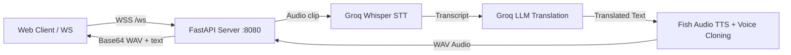

# Voxlate — Speech Translation Service

FastAPI WebSocket service for real-time speech-to-text, neural translation, and voice-cloned text-to-speech.

## Architecture



## Setup & Running

1. **Create virtual environment**:
   ```bash
   python -m venv .venv
   # Windows:
   .venv\Scripts\activate
   # Linux/macOS:
   source .venv/bin/activate
   ```

2. **Install dependencies**:
   ```bash
   pip install -r requirements.txt
   ```

3. **Configure environment**:
   ```bash
   cp .env.example .env
   # Set DATABASE_URL, GROQ_API_KEY, FISH_API_KEY, JWT_SECRET, FRONTEND_URL
   ```

4. **Start the server**:
   ```bash
   uvicorn connector_stream:app --host 0.0.0.0 --port 8080 --reload
   ```

## Running Tests

```bash
python -m unittest discover -s tests -v
```

